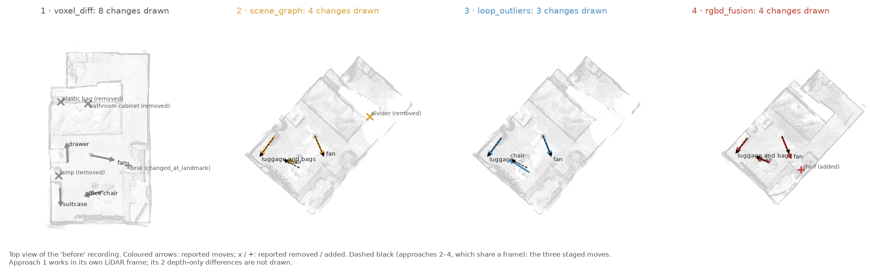
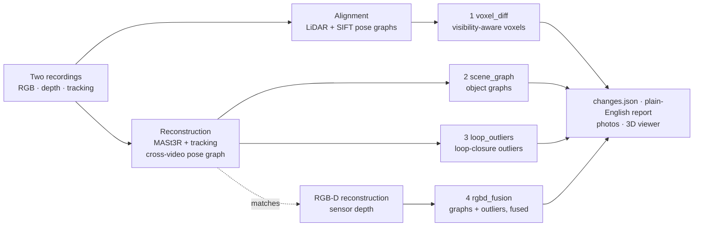

# NavDelta: spatial scene differencing

Compare **two phone recordings of the same room** and find out **what changed**.
NavDelta puts both recordings into one shared 3D frame, finds the objects that were
**moved, added or removed**, names them with **open-source models**, and
**describes each change in plain English**. It shows the changes in an
interactive 3D viewer, with before/after photos.

NavDelta has **four approaches**. Each one runs on its own and is reproducible on its own. They
share the data format, the output format ([`changes.json`](docs/changes-schema.md)) and the viewer.
Nothing is trained or fine-tuned, and no data is labelled by hand.

**Input:** two recordings of the same space from a LiDAR phone (iPhone / iPad Pro), exported with
[Polycam](https://poly.cam) as raw data: RGB keyframes, the phone's ARKit camera poses and depth
maps ([data-format.md](docs/data-format.md)). Approaches 2 and 3 use only the keyframes and poses.
A plain video without camera poses is not supported.

**Quick start** (Docker, NVIDIA GPU optional):

```bash
# put the two recordings in ./data (download link below), then
./run.sh rgbd_fusion          # or voxel_diff | scene_graph | loop_outliers; .\run.ps1 on Windows
# -> outputs/rgbd_fusion/CHANGE_REPORT.md, changes.json, viewer/index.html
```


**Interactive 3D viewers**, one per approach, run in the browser:
[1 voxel_diff](https://swithinraj.github.io/nav-delta-spatial-scene-differencing/results/voxel_diff/viewer/) ·
[2 scene_graph](https://swithinraj.github.io/nav-delta-spatial-scene-differencing/results/scene_graph/viewer/) ·
[3 loop_outliers](https://swithinraj.github.io/nav-delta-spatial-scene-differencing/results/loop_outliers/viewer/) ·
[4 rgbd_fusion](https://swithinraj.github.io/nav-delta-spatial-scene-differencing/results/rgbd_fusion/viewer/).
You can also open `results/<approach>/viewer/index.html` locally. In the viewer you can switch
between before and after, cut away the ceiling, and click a change to fly to it and see its photos.

**Contents:**
- [The four approaches](#the-four-approaches)
- [Results](#results)
- [Design choices and trade-offs](#design-choices-and-trade-offs)
- [How it works](#how-it-works)
- [Reproduce](#reproduce)
- [Datasets, models and citations](#datasets-models-and-citations)
- [Repository layout](#repository-layout)
- [Limitations](#limitations)

## The four approaches

| # | Approach | Needs | Finds changes by | Write-up |
|---|---|---|---|---|
| 1 | `voxel_diff` | RGB + LiDAR depth + tracking | ray-casting both recordings into voxels: changed = seen occupied in one, seen empty in the other | [voxel_diff.md](docs/voxel_diff.md) |
| 2 | `scene_graph` | RGB + tracking | a 3D scene graph per recording (objects + "on" / "next to"), compared object by object, every claim checked against the other recording's depth | [scene_graph.md](docs/scene_graph.md) |
| 3 | `loop_outliers` | RGB + tracking | closing one loop between the recordings and keeping what SLAM throws away: the feature matches that disagree are the changes | [loop_outliers.md](docs/loop_outliers.md) |
| 4 | `rgbd_fusion` | RGB + depth + tracking | approaches 2 and 3 on the recording's measured depth, with RGB-D SLAM's gates, fused: one detector confirms or vetoes the other | [rgbd_fusion.md](docs/rgbd_fusion.md) |

[related_work.md](docs/related_work.md) explains how approaches 3 and 4 differ from existing change
detection, with references.

Approach 1 aligns the recordings with its own LiDAR pipeline ([alignment.md](docs/alignment.md)).
Approaches 2–4 share an RGB reconstruction: MASt3R matches and the phone's tracking, locked
together by a cross-video pose graph ([reconstruction.md](docs/reconstruction.md)). Approach 4
runs the same pose graph on the recording's own depth maps.

## Results

### Our room

Three changes were staged ([`room_changes.txt`](results/room_changes.txt)): the trolley bag
turned perpendicular to the wall, the office chair moved away from the table, and the tower fan
moved near the table. All three are moves. Added and removed objects are scored on the warehouse
benchmark below.



| Approach | Staged changes found | Reported as a move, both places right | Other changes reported | Run time | Results |
|---|---|---|---|---|---|
| 1 `voxel_diff` | **3 / 3** | 3 / 3 | 5 (a chest of drawers pushed ~0.2 m, smaller items; 2 more flagged depth-only) | 11 min | [report](results/voxel_diff/CHANGE_REPORT.md) · [json](results/voxel_diff/changes.json) |
| 2 `scene_graph` | **3 / 3** | 3 / 3 | 1 (a divider "removed"; not staged) | 18 min reconstruction + 15 min | [report](results/scene_graph/CHANGE_REPORT.md) · [json](results/scene_graph/changes.json) |
| 3 `loop_outliers` | **3 / 3** | 3 / 3 | 0 | 18 min reconstruction + 1 min | [report](results/loop_outliers/CHANGE_REPORT.md) · [json](results/loop_outliers/changes.json) |
| 4 `rgbd_fusion` | **3 / 3**, all confirmed by both detectors | 3 / 3 | 1 (a shelf "added" beside the bathroom mirror; one detector only) | ≤ 18 min MASt3R matches (reused if 2 or 3 ran) + 2 min RGB-D reconstruction + 18.5 min | [report](results/rgbd_fusion/CHANGE_REPORT.md) · [json](results/rgbd_fusion/changes.json) |

Run times are on an RTX 3050 Laptop GPU (4 GB); for approaches 2–4 they come from the
`navdelta verify` runs. Approaches 2–4 share the 18-minute RGB reconstruction (approach 4 uses
only its matches), so running all three costs it once.

What each approach says about the staged changes:

| Staged change | 1 `voxel_diff` | 2 `scene_graph` | 3 `loop_outliers` | 4 `rgbd_fusion` |
|---|---|---|---|---|
| The travel trolley bag was moved perpendicular to the adjacent wall. | suitcase moved 0.54 m, turned ~100°; now perpendicular to the wall | luggage and bags moved 0.83 m; now next to the curtain | luggage moved 0.54 m, turned ~80° (from 437 of its own features) | luggage and bags moved 0.55 m, turned ~86° (from 879 of its own features); both detectors |
| The office chair was moved further away from the table. | office chair moved 0.57 m; 0.20 → 0.84 m from the desk | chair moved 0.38 m; now next to the radiator | chair moved 0.51 m | chair moved 0.50 m; 0.60 → 1.22 m from the desk; both detectors |
| The tower ventilator was moved near the table. | fan moved 0.71 m; 0.74 → 0.02 m from the desk | fan moved 0.74 m; now next to the desk | fan moved 0.74 m (vanished + look-alike appeared) | fan moved 0.95 m; now next to the desk, 0.06 m from the television (was 1.33 m); both detectors |

| Suitcase turned | Fan moved next to the desk | Chair moved away from the desk |
|---|---|---|
|  |  |  |

*Approach 1's photo pairs: the same viewpoint in both recordings. Filled: where the object is in
that photo. Dashed: where it is in the other recording.*

### Five warehouses (ChangeSim)

One room cannot rank four approaches. So all four were also run on five pairs of recordings of
simulated warehouses from the public ChangeSim dataset [[Park et al. 2021]](#datasets-models-and-citations),
54–102 changed objects per pair, with the `large_space` profile ([profiles.md](docs/profiles.md)).
The profile was tuned on two pairs (warehouse 6), and the other three warehouses were held out.
A claim is correct within 30 cm of a changed object.


| Approach | Tuning pairs (W6) F1 | Held-out pairs (W7–W9) F1 | Held-out precision / recall | All 5 pairs F1 |
|---|---|---|---|---|
| 1 `voxel_diff` | 0.31 | 0.38 | 0.39 / 0.36 | 0.35 |
| 2 `scene_graph` | 0.21 | 0.16 | 0.39 / 0.10 | 0.18 |
| 3 `loop_outliers` | 0.35 | 0.40 | 0.46 / 0.35 | 0.38 |
| 4 `rgbd_fusion` | **0.43** | **0.55** | **0.76 / 0.43** | **0.50** |


- Approach 4 has the best F1 on each of the five pairs, and the highest precision overall.
- Approach 1 finds the most *removed* objects. Approach 4 finds the most added, rotated and
  replaced ones.
- Fusion pays off: the scene graphs alone (2) and the outliers alone (3) score 0.18 and 0.38 over
  all five pairs. Fused on measured depth (4), they score 0.50.
- Warehouses are hard. Most changes are boxes 20–60 cm across, seen from 3–15 m away, and no
  approach finds more than 60 % of them on any pair.

Full protocol, per-pair tables, run times, registration errors, recall per change type and every
tuning trial are in [benchmark.md](docs/benchmark.md). The raw records are in
[`benchmarks/results/`](benchmarks/results/).

<br clear="right">

## Design choices and trade-offs

- **Four approaches.** They are not variations of one pipeline; they use different evidence. The
  RGB-D fusion (4) is the most accurate. Voxel differencing (1) uses only permissively licensed
  models and is the fastest. Loop-closure outliers (3) work from RGB alone. Scene graphs (2) carry
  the semantics that approach 4 builds on. One CLI, one output format and one viewer keep the four
  interchangeable.
- **Visibility before claims.** A change is only declared where the other recording actually
  looked: ray-cast voxels (1), or projection into the other recording's depth (2–4). This is how
  viewpoint, occlusion and incomplete scans are kept from looking like change. The price is
  coverage: unseen space is reported as unknown, never as removed.
- **Geometry decides, models name.** Detection comes from depth and poses. Florence-2, SAM 2.1 and
  SigLIP 2 only outline and name things, and sentences are filled from measurements. No language
  model writes them. That keeps the descriptions consistent with the geometry, at the cost of
  plainer wording.
- **The phone's tracking plus one pose graph**, not a from-scratch reconstruction. ARKit poses are
  accurate within a recording but drift between recordings. A cross-video pose graph removes that
  drift: held-out matches agree to 1.9–2.6 cm in the room ([reconstruction.md](docs/reconstruction.md)).
- **No training, pinned models, deterministic stages.** Every stage hashes its result, and
  `navdelta verify` checks that two runs agree. The trade-off is that the thresholds are tuned by
  hand: on our room, and for large spaces on two warehouse pairs, with three more held out.
- **Measured, not just demonstrated.** One room with three staged moves cannot rank four designs.
  The warehouse benchmark (five pairs, ground truth, held-out pairs) is what the comparison and
  the recommendation below rest on.

### Which one to use

- **With depth maps** (LiDAR phone, RGB-D camera): **`rgbd_fusion`** is the most accurate. It
  confirmed all three staged changes with both detectors and had the best F1 and precision on the
  warehouses. It depends on MASt3R, which is licensed for non-commercial use only.
- **With depth maps, permissive licences only**: **`voxel_diff`**. It is the fastest on the room
  (11 min), is strongest on removed objects, and also reports small pushes. It needs the
  recording's mesh export as well.
- **RGB only** (no depth sensor): **`loop_outliers`**. It measures each moved object's distance
  and turn from its own features, and only segments what changed.
- **`scene_graph`** is the weakest on warehouses and, like approach 4, runs three models on every
  keyframe (15 min for the room on a 4 GB GPU). Its object graph (names, "on" / "next to") is
  what approach 4 builds on.

## How it works



What the approaches have in common:

- **Unknown is not "removed".** Every approach only declares a change where the other recording
  actually looked. Approach 1 ray-casts voxels; approaches 2–4 project each object or feature into
  the other recording's depth. An incomplete scan cannot create false removals.
- **Geometry decides, models name.** What changed comes from depth and poses. Open-source models
  (Florence-2, SAM 2.1, SigLIP 2) only outline and name things. Sentences are filled from measured
  distances, turns and the unchanged furniture nearby. No language model writes them.
- **Two scale profiles.** One for a room and one for a large space, chosen automatically from the
  camera path ([profiles.md](docs/profiles.md)). The room values equal the code's defaults
  (`python -m navdelta.config --check`).
- **One ID everywhere.** `M1` is the same change in the report, in `changes.json`, in the 3D
  viewer and in its photos.

## Reproduce

### The room, one approach at a time

**1. Get the data.** Download the two recordings from **[Google Drive](https://drive.google.com/drive/folders/191dyNnh4FeqqfE-fsZqGGhxpD8AQnEd1?usp=drive_link)**
and unpack them into `data/`:

```text
data/Myroomesh1_imgs/  data/Myroomesh1_rawdata/  data/Myroomesh1_ply/
data/Myroomesh2_imgs/  data/Myroomesh2_rawdata/  data/Myroomesh2_ply/
```

**2. Run.** This needs [Docker](https://docs.docker.com/get-docker/). It uses an NVIDIA GPU if
there is one (on Windows: Docker Desktop with the WSL 2 backend), otherwise the CPU. Name the
approach first; without a name, approach 1 runs.

```bash
./run.sh                    # approach 1, voxel_diff        (Linux / WSL)
./run.sh scene_graph        # approach 2
./run.sh loop_outliers      # approach 3
./run.sh rgbd_fusion        # approach 4
.\run.ps1 rgbd_fusion       # the same in Windows PowerShell
```

Each approach has its own image, `nav-delta-<approach>:1.0.0`
([`Dockerfile`](Dockerfile), [`docker-compose.yml`](docker-compose.yml)). Its first run builds the
image and downloads the model weights (pinned revisions, cached in `.hf_cache/`). Each approach
runs on its own. Approach 4 computes its RGB-D reconstruction itself, and only reuses approach 2's
matches and detections if they are already in `outputs/`.

**3. Look at the results** in `outputs/<approach>/`:
- `viewer/index.html`: open it in a browser;
- `CHANGE_REPORT.md`: every change in plain English;
- `changes.json`: the same, machine-readable ([format](docs/changes-schema.md)).

The committed reference results ([`results/`](results/README.md)) are what these commands produce
on our room recordings.

**4. Check reproducibility.** `./run.sh <approach> verify` runs the approach twice, recomputing
every stage and every cache, and fails unless every stage produces identical result hashes. All
four approaches pass on our room recordings, with every stage identical. Approaches 2–4 ran
with `--skip-shared`: every approach stage twice, the 2D detections included, on one shared
reconstruction. The run records are in `results/<approach>/run_log.json`. That shared RGB
reconstruction, run again from scratch (MASt3R fetched fresh at its pinned commit), reproduced the
reference bit for bit: every camera pose and depth map identical.

**In Docker:**
- All four images build.
- Approach 1's `verify` passes inside its container: every stage identical, alignment included.
- Approach 4 ran end to end in its container, from an empty outputs folder. There it computes its
  own MASt3R matches instead of reusing approach 2's. It found the same 3 staged moves, all
  confirmed by both detectors (chair 0.52 m, fan 0.85 m, luggage 0.53 m turned ~84°). It made
  3 extra claims instead of 1: a paper "moved", and a shelf "removed" and "added" by the mirror.
  The committed results reuse approach 2's matches and detections, as `outputs/` does after
  approach 2 has run. The difference comes from that, and from Linux vs Windows arithmetic.
- On Docker Desktop for Windows, `docker compose run` occasionally fails with an "Internal Server
  Error" from the engine. Restarting Docker Desktop fixes it.

### Without Docker

Requires Python 3.12 or newer and the pinned versions in [`requirements.txt`](requirements.txt).
Approach 1's geometry stages need Open3D, which has no Windows wheel for recent Python versions, so
use Linux, WSL or Docker for it. The reference results of approaches 2–4 were produced natively
(Windows, Python 3.13, RTX 3050 4 GB) with the same commands; approach 1's in Docker.

```bash
python -m venv .venv && source .venv/bin/activate
pip install torch==2.13.0 torchvision==0.28.0 --index-url https://download.pytorch.org/whl/cu126
pip install -r requirements.txt && pip install -e .
navdelta run --approach rgbd_fusion --data data
```

| Command | What it does |
|---|---|
| `navdelta run --approach NAME` | the whole pipeline of one approach, shared stage included |
| `navdelta verify --approach NAME` | run twice, require identical results for every stage |
| `navdelta check-data --approach NAME` | check that a data folder holds two usable recordings for that approach |
| `navdelta align` / `reconstruct` / `reconstruct-rgbd` | a shared stage only (approach 1 / 2–3 / 4) |
| `navdelta detect --approach NAME` | everything after the shared stage |
| `navdelta run --approach NAME --from STAGE --to STAGE` | rerun some stages (`navdelta stages` lists them) |

Options: `--data`, `--outputs`, `--before NAME --after NAME`, `--profile auto|room|large_space|FILE`,
`--cpu`. Every run appends its stages, run times, peak GPU memory and result hashes to
`outputs/runs.jsonl`. With Docker, commands and options go after the approach name
(`./run.sh scene_graph run --cpu`). Folders are set with `NAVDELTA_DATA_DIR`, `NAVDELTA_OUT_DIR`
and `NAVDELTA_MODEL_DIR` (defaults `./data`, `./outputs`, `./.hf_cache`).

### The warehouse benchmark

[`benchmarks/`](benchmarks/README.md) downloads only the ChangeSim files each pair needs, converts
them to the phone-export layout with a ground truth, runs the approaches and scores them:

```bash
python benchmarks/prepare.py                                   # download, convert, shared stages (5 pairs)
for a in voxel_diff scene_graph loop_outliers rgbd_fusion; do
  python benchmarks/final_eval.py --approach $a --profile tuned --device cuda
done
python benchmarks/final_report.py                              # tables -> docs/benchmark.md
python benchmarks/make_figures.py                              # figures -> docs/images/
```

## Use your own recordings

Any two recordings of the same space in the Polycam raw-data layout work.
[`docs/data-format.md`](docs/data-format.md) lists the required files and which approach needs
which. Check a folder with `navdelta check-data --approach NAME --data PATH` before running. For a
hall or warehouse, the `large_space` profile is chosen automatically.

## Datasets, models and citations

**The room**: our two recordings of one room, captured with a LiDAR phone and exported with
Polycam (raw data). Between them, three changes were staged ([`room_changes.txt`](results/room_changes.txt)).

**ChangeSim**, the warehouse benchmark. It was not redistributed: `benchmarks/prepare.py` reads
the needed files from the official archives ([github.com/SAMMiCA/ChangeSim](https://github.com/SAMMiCA/ChangeSim)).

```bibtex
@inproceedings{park2021changesim,
  author    = {Park, Jin-Man and Jang, Jae-hyuk and Yoo, Sahng-Min and Lee, Sun-Kyung and Kim, Ue-hwan and Kim, Jong-Hwan},
  title     = {ChangeSim: Towards End-to-End Online Scene Change Detection in Industrial Indoor Environments},
  booktitle = {IEEE/RSJ International Conference on Intelligent Robots and Systems (IROS)},
  year      = {2021},
  url       = {https://arxiv.org/abs/2103.05368}
}
```

**Models.** All are used as published, at pinned revisions; nothing is trained or fine-tuned.

| Model | Paper | Licence | Used by |
|---|---|---|---|
| [SAM 2.1](https://huggingface.co/facebook/sam2.1-hiera-base-plus) | Ravi et al., *SAM 2: Segment Anything in Images and Videos*, 2024 ([arXiv:2408.00714](https://arxiv.org/abs/2408.00714)) | Apache-2.0 | all four (masks) |
| [Florence-2-large](https://huggingface.co/florence-community/Florence-2-large) | Xiao et al., *Florence-2*, CVPR 2024 ([arXiv:2311.06242](https://arxiv.org/abs/2311.06242)) | MIT | all four (names, furniture) |
| [SigLIP 2 so400m](https://huggingface.co/google/siglip2-so400m-patch14-384) | Tschannen et al., *SigLIP 2*, 2025 ([arXiv:2502.14786](https://arxiv.org/abs/2502.14786)) | Apache-2.0 | all four (names, look-alikes) |
| [SmolVLM2-500M](https://huggingface.co/HuggingFaceTB/SmolVLM2-500M-Video-Instruct) | Marafioti et al., *SmolVLM*, 2025 ([arXiv:2504.05299](https://arxiv.org/abs/2504.05299)) | Apache-2.0 | 1 (colour words, optional) |
| [MASt3R](https://github.com/naver/mast3r) | Leroy et al., *Grounding Image Matching in 3D with MASt3R*, ECCV 2024 ([arXiv:2406.09756](https://arxiv.org/abs/2406.09756)) | **CC BY-NC-SA 4.0** | 2, 3, 4 (matches; depth for 2 and 3) |

The ScanNet200 class names (Rozenberszki et al., ECCV 2022) serve as the zero-shot vocabulary.
Approach 1 uses only permissively licensed models. Approaches 2–4 depend on MASt3R, which is
licensed for non-commercial use only ([licences.md](docs/licences.md)). The methods approaches 3
and 4 build on and differ from are cited in [related_work.md](docs/related_work.md).

## Repository layout

```text
navdelta/                         the package (one CLI: `navdelta`)
  cli.py, context.py, config.py   entry point, run configuration, scale profiles
  configs/                        room.toml, large_space.toml
  alignment/                      shared stage of approach 1: LiDAR recordings -> one 3D frame
  recon/                          shared stage of approaches 2-4: RGB (or RGB-D) reconstruction
  approaches/voxel_diff/          approach 1, one module per stage
  approaches/scene_graph/         approach 2
  approaches/loop_outliers/       approach 3
  approaches/rgbd_fusion/         approach 4 (wraps stages of 2 and 3, adds fuse)
  common/                         frame loading, projection, device, data check, viewer data
  viewer/index.html               3D viewer shared by all approaches
docs/                             one write-up per approach, shared stages, profiles, benchmark,
                                  related work, data and output formats, licences
results/                          reference results on our room recordings, one folder per approach
benchmarks/                       ChangeSim download + conversion, scoring, tuning, figures; results/
Dockerfile, docker-compose.yml, run.sh, run.ps1, requirements.txt, pyproject.toml
```

**Adding another approach:** create `navdelta/approaches/<name>/` with `REQUIRES` (its shared
stage), `STAGES`, `result_hashes()` and `summary()`, and register it in
[`navdelta/approaches/__init__.py`](navdelta/approaches/__init__.py). It reuses the shared stages,
the frame utilities and the viewer, and writes the same [`changes.json`](docs/changes-schema.md).

## Limitations

- **Coverage.** Only space seen by both recordings can be compared. In the room, that is 46 % of
  the occupied space.
- **Small things.** Objects smaller than about 15 cm (room) or 30 cm (large space) are not
  reliably found by any approach.
- **Input.** A recording must come with the phone's camera poses (Polycam raw-data export from a
  LiDAR iPhone / iPad Pro). A plain video is not enough.
- **Extra claims in the room.** Approaches 2 and 4 each report one false change: a divider
  "removed", and a shelf "added" beside a mirror (depth sensors see through mirrors and glass).
  Approach 1 reports 5 changes beyond the 3 staged ones, such as a chest of drawers pushed
  ~0.2 m. They are not in the staged list, so they are unverified.
- **The room has only moves.** Added and removed objects are scored only on the simulated
  warehouses.
- **Labels and relations** come from general-purpose models and simple geometric rules, and the
  sentences built from them can slip. Approach 1 flags two-model disagreements, and the tower fan
  is only "fan". Approach 2 names the trolley bag "luggage and bags". In approach 2's report, the
  chair was "on the speaker" though 0.30 m from it, and the fan is "next to the divider" that
  another change reports removed: two objects share the name. Plural landmarks are referred to
  as "it" ("the clothes: 2.67 m from it").
- **Rotation** is measured to about ±10° by approaches 1 and 3 (shape fit, own features). The
  scene graph's footprint estimate, which approach 4 uses when the outliers do not measure a
  move, is rougher.
- **Warehouses are hard for all four.** On ChangeSim, no approach finds more than 60 % of the
  changed objects on any pair; see [benchmark.md](docs/benchmark.md).
- **Licences.** Approaches 2–4 depend on MASt3R (non-commercial).
