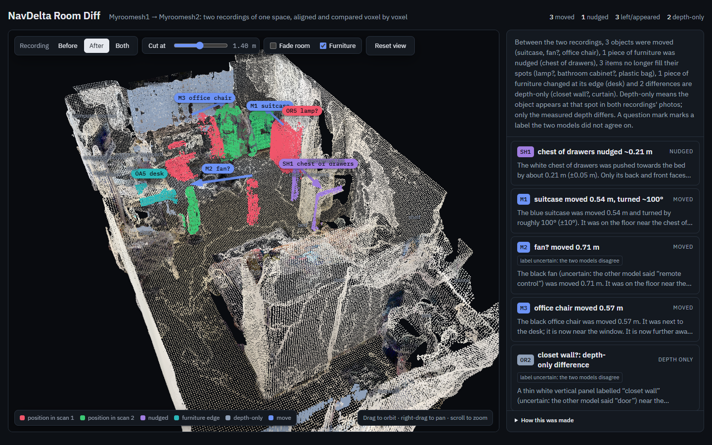
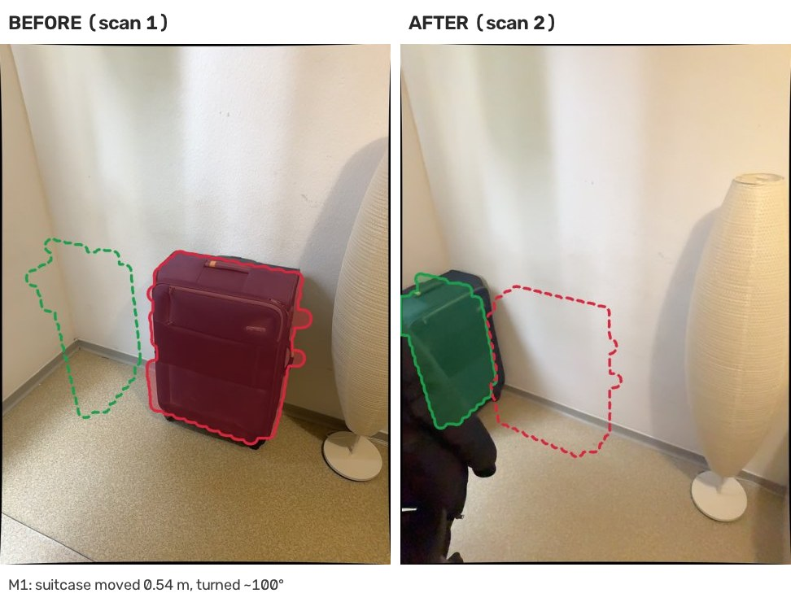
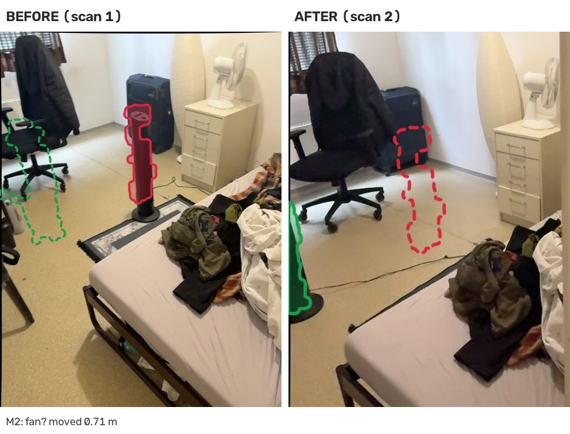
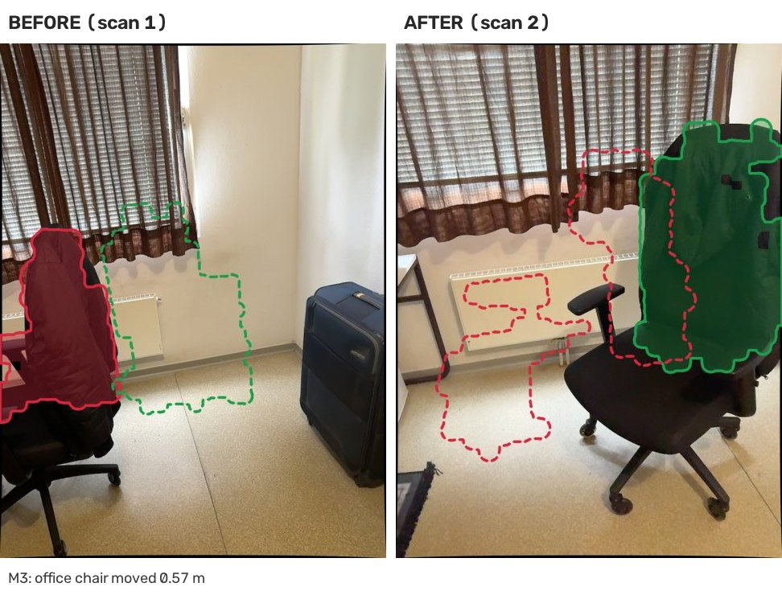
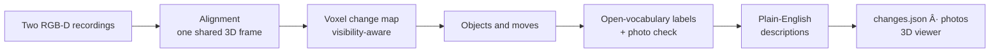

# NavDelta: spatial scene differencing

Compare **two phone recordings of the same room** and find out **what changed**.
NavDelta puts both recordings into one shared 3D frame, finds objects that were
**moved, added or removed**, names them with **open-source models**, and
**describes each change in plain English**. It shows the changes in an
interactive 3D viewer, with before/after photos for every one.



**[Open the interactive 3D viewer](https://swithinraj.github.io/nav-delta-spatial-scene-differencing/results/voxel_diff/viewer/)**
in the browser, or open [`results/voxel_diff/viewer/index.html`](results/voxel_diff/viewer/index.html) locally.
Switch between before and after, cut away the ceiling, and click a change to fly
to it and see its photos.

## Results on the provided recordings

| Check | Result |
|---|---|
| Staged changes found ([`room_changes.txt`](results/room_changes.txt)) | **3 / 3** |
| Object named correctly | **3 / 3**; the fan's label is flagged, because only one of the two models said "fan" |
| Spatial relation of each staged change reproduced | **3 / 3**: the fan went from 0.74 to 0.02 m from the desk, the chair from 0.20 to 0.84 m from it, and the bag from parallel to perpendicular to the wall |
| Each move's old and new position labelled independently, and the labels agree | **4 / 4**, including the pushed chest of drawers |
| Depth artefacts kept out of the change list | **2**: the sheer curtains and the door are reported as depth-only, because both recordings' photos show the same object |
| Reproducible | identical result hashes for every stage over two full runs |

The staged changes, in their own words and in NavDelta's:

| Staged change | What NavDelta reports |
|---|---|
| The tower ventilator was moved near the table. | **fan** moved 0.71 m. It is now 0.02 m from the desk, compared with 0.74 m before. |
| The office chair was moved further away from the table. | **office chair** moved 0.57 m. It is now 0.84 m from the desk, compared with 0.20 m before. |
| The travel trolley bag was moved perpendicular to the adjacent wall. | **suitcase** moved 0.54 m and turned ~100°. It was parallel to the wall and is now perpendicular to it. |

| Suitcase turned | Fan moved next to the desk | Chair moved away from the desk |
|---|---|---|
|  |  |  |

*The same viewpoint in both recordings. Filled: where the object is in that
photo. Dashed: where it is in the other recording.*

It also reports, without being told:
- a chest of drawers pushed ~0.2 m;
- a lamp edge, a shelf item and a plastic bag no longer in their spots;
- a change at the desk's edge.

Two depth differences are flagged as **depth-only**, because the photos show
the same object in both recordings: the sheer curtains (most likely seen through
by the depth sensor in one recording) and the far door. Full list: [`results/voxel_diff/CHANGE_REPORT.md`](results/voxel_diff/CHANGE_REPORT.md).

## How it works



1. **Alignment.** A pose graph per recording, built from ARKit VIO and
   depth-verified SIFT factors, followed by gravity-locked registration of
   recording 2 into recording 1's frame. [Details](docs/alignment.md)
2. **Change map.** Both recordings are ray-cast into 5 cm voxels. A voxel
   changed only if one recording saw it occupied and the other saw it empty.
   Unobserved space stays *unknown*.
3. **Objects and moves.** Regions are grouped into objects. Removed objects are
   matched to added ones by shape, height and colour, which also tells a move
   from a small push.
4. **Labels.** Open-source models name each object. Then the same spot is
   checked in the other recording's photos.
5. **Descriptions.** Sentences are filled from the measurements: distances,
   rotation, wall orientation, and the nearest static furniture.

What makes the approach different:

- **Unknown is not "removed".** A change is declared only where both
  recordings actually observed the space (ray casting), so an incomplete scan
  can't create false removals.
- **Move or push?** A removed and an added object count as a move only if the
  path between them was seen empty. Otherwise they are the two faces of one
  object that was pushed. This is how the drawer unit was caught.
- **Every change is cross-examined in photos.** The pipeline picks the most
  similar viewpoints in both recordings and labels the same spot in the *other*
  recording too. Depth artefacts, such as sheer curtains the sensor saw
  through, are caught automatically.
- **Words come from measurements.** Sentences are filled from measured
  distances, angles and furniture that is static in both scans. No language
  model writes them; a small VLM supplies colour words only.
- **One ID everywhere.** `M1` is the same change in the report, in
  `changes.json`, in the 3D viewer and in its photo pair.

Geometry decides what changed; the models only name things. Nothing is
trained or fine-tuned, and no data is labelled by hand.

| Model | Licence | Used for |
|---|---|---|
| [SAM 2.1](https://huggingface.co/facebook/sam2.1-hiera-base-plus) | Apache-2.0 | object masks |
| [Florence-2-large](https://huggingface.co/florence-community/Florence-2-large) | MIT | object names, furniture detection |
| [SigLIP 2 so400m](https://huggingface.co/google/siglip2-so400m-patch14-384) | Apache-2.0 | label cross-check (ScanNet200 vocabulary) |
| [SmolVLM2-500M](https://huggingface.co/HuggingFaceTB/SmolVLM2-500M-Video-Instruct) | Apache-2.0 | colour words (optional) |

The complete write-up of the approach, including what went wrong during
development and how it was fixed, is in [`docs/voxel_diff.md`](docs/voxel_diff.md).

## Quick start

**1. Get the data.** Download the two recordings from **[Google Drive](https://drive.google.com/drive/folders/191dyNnh4FeqqfE-fsZqGGhxpD8AQnEd1?usp=drive_link)**
and unpack them into `data/`:

```text
data/Myroomesh1_imgs/  data/Myroomesh1_rawdata/  data/Myroomesh1_ply/
data/Myroomesh2_imgs/  data/Myroomesh2_rawdata/  data/Myroomesh2_ply/
```

**2. Run.** This needs [Docker](https://docs.docker.com/get-docker/). It uses an
NVIDIA GPU if there is one (on Windows: Docker Desktop with the WSL 2 backend),
otherwise the CPU.

```bash
./run.sh            # Linux / WSL
.\run.ps1           # Windows PowerShell
```

The first run builds the Docker image `nav-delta-voxel_diff:1.0.0` (about 8.6 GB) and downloads the model weights
(about 8 GB, pinned revisions, cached in `.hf_cache/`). After that, a full run
takes about 11 minutes on an RTX 3050 Laptop GPU (4 GB). Alignment, the change
map and matching take about 4.5 minutes on the CPU; labelling and landmarks
take about 6 minutes on the GPU.

**3. Look at the results** in `outputs/voxel_diff/`:
- `viewer/index.html`: open it in a browser;
- `CHANGE_REPORT.md`: every change in plain English;
- `changes.json`: the same, machine-readable.

**Reproducibility:** `./run.sh verify` (or `.\run.ps1 verify`) runs the whole
pipeline twice and fails unless every stage produces identical result hashes.
This was checked on the provided recordings: identical across both runs
(`results/voxel_diff/run_log.json`).

### Without Docker

Requires Python 3.12. On Windows, use WSL. Docker is the tested path; these steps
install the same pinned versions.

```bash
python -m venv .venv && source .venv/bin/activate
pip install torch==2.13.0 torchvision==0.28.0 --index-url https://download.pytorch.org/whl/cu126
pip install -r requirements.txt && pip install -e .
navdelta run --data data
```

### Command line

| Command | What it does |
|---|---|
| `navdelta run` | the whole pipeline: alignment → change detection → labels → descriptions → viewer |
| `navdelta verify` | run twice, require identical results for every stage |
| `navdelta check-data` | check that a data folder holds two usable recordings |
| `navdelta align` / `navdelta detect` | alignment only / everything after it |
| `navdelta run --from labels` | rerun from a stage (`navdelta stages` lists them) |

Options: `--data`, `--outputs`, `--before NAME --after NAME`, `--from STAGE`, `--cpu`.

With Docker, commands and options go to `run.sh` / `run.ps1` unchanged
(e.g. `./run.sh run --cpu`). Folders are set with environment variables
instead of `--data` / `--outputs`:

```bash
NAVDELTA_DATA_DIR=/path/to/recordings ./run.sh check-data       # Linux / WSL
$env:NAVDELTA_DATA_DIR='D:\scans'; .\run.ps1 check-data          # PowerShell
```

The other two are `NAVDELTA_OUT_DIR` (default `./outputs`) and
`NAVDELTA_MODEL_DIR` (default `./.hf_cache`).

## Use your own recordings

Any two recordings of the same space in the Polycam raw-data layout work.
[`docs/data-format.md`](docs/data-format.md) lists the required files and
conventions. Check a folder with `navdelta check-data --data PATH` before running.

## Repository layout

```text
navdelta/
  cli.py, context.py           entry point and run configuration
  alignment/                   shared: two recordings → one 3D frame
  approaches/voxel_diff/       approach 1 (this one), one module per stage
  common/                      frame loading, projection, device, data check
  viewer/index.html            3D viewer shared by all approaches
docs/                          approach write-up, alignment, data format, output format, validation notes
results/                       reference results of this run (viewer included)
Dockerfile, docker-compose.yml, run.sh, run.ps1, requirements.txt, pyproject.toml
```

**Adding another approach:** create `navdelta/approaches/<name>/` with
`STAGES`, `result_hashes()` and `summary()`, register it in
[`navdelta/approaches/__init__.py`](navdelta/approaches/__init__.py), and run
it with `navdelta run --approach <name>`. It reuses the alignment, the frame
utilities and the viewer, and writes the same [`changes.json`](docs/changes-schema.md).

## Limitations

- **Coverage.** Only space seen by both recordings can be compared; here that
  is 46% of the occupied space.
- **Detection floor.** Objects smaller than about 15 cm can't be detected.
- **Labels.** They come from general-purpose models, and two-model
  disagreements are flagged. Examples: the tower fan is only "fan", and the
  door is mislabelled "closet wall".
- **Rotation.** Measured to about ±10°.
- **Tested on one room.** The thresholds that were measured on this scene are
  listed in [`docs/validation/`](docs/validation/).
