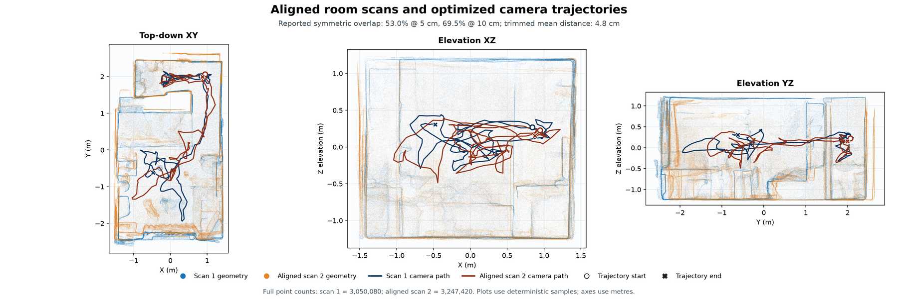

# Alignment: putting both recordings into one 3D frame

`navdelta align` (also the first stage of `navdelta run`) gives every keyframe of
both recordings a camera pose in **one shared coordinate frame**: the PLY frame
of the "before" recording (metres, Z up). It writes `outputs/alignment/`. Every
change-detection approach builds on this.

Code: [`navdelta/alignment/align.py`](../navdelta/alignment/align.py) (pose graphs
and registration), [`qa_overlays.py`](../navdelta/alignment/qa_overlays.py)
(review images) and [`validate.py`](../navdelta/alignment/validate.py) (checks
and the SHA-256 manifest).

*Blue: recording 1. Orange: recording 2 after alignment. Lines: camera
trajectories. The outer walls, the internal partition and the room corners
coincide.*

## Method: hybrid RGB-D + visual-inertial pose graph

The saved keyframes are sparse (about 1 per second), while the phone's ARKit
visual-inertial odometry (VIO) tracks pose metrically, with gravity, at 60 Hz.
So the VIO trajectory is the backbone, and the images correct it offline.

1. **Initial poses.** Each keyframe starts from its ARKit pose, converted to the
   PLY frame (formula in [data-format.md](data-format.md)). The formula is
   checked by back-projecting depth into the recording's own PLY.
2. **Depth-verified visual factors.** Mutual-ratio SIFT matches are lifted to 3D
   through both depth maps. A robust SE(3) fit keeps a factor only with enough
   inliers, a low residual, and a bounded departure from the VIO estimate.
3. **Pose graph per recording.** The graph combines:
   - VIO absolute and sequential factors;
   - gated Polycam anchors;
   - RGB-D sequential, skip (gap 2 and 4) and loop-closure factors.

   Open3D Levenberg–Marquardt optimisation then runs with skip and loop factors
   as prunable "uncertain" edges.
4. **Registration of recording 2 into recording 1.** This uses:
   - a PCA yaw initialisation aware of the 180° ambiguity;
   - ten yaw seeds;
   - robust multiscale point-to-plane ICP;
   - an RGB-D cross-view consistency check.
5. **Gravity lock.** A final 4-DoF refinement estimates yaw and XYZ only. Roll
   and pitch stay at the gravity both phones measured, so a moved object cannot
   tilt the room.
6. **Export and validation.** The stage exports:
   - every pose (JSON per frame, JSONL, TUM trajectory);
   - every graph factor (measurement, information, pruning status, residual);
   - the transformed PLY;
   - review images and a validation report.

Every frame is exported. Each frame carries a `pose_support` label (high,
medium, or VIO-only/low), and the change detection uses this label to weight
frames.

## Result on our room recordings

| | Myroomesh1 | Myroomesh2 |
|---|---:|---:|
| RGB-D keyframes | 204 | 223 |
| RGB-D sequential factors accepted | 158 / 203 | 165 / 222 |
| Median / p95 translation correction | 12.5 / 46.0 mm | 12.5 / 56.3 mm |
| Frames with high / medium / VIO-only support | 163 / 2 / 39 | 165 / 15 / 43 |
| Own RGB-D reconstruction → own PLY, median | 14.2 mm | 17.1 mm |

**Transform from recording 2 to recording 1:** a yaw of 90.76° and a
translation of (−25.9, +138.5, −0.5) mm. Roll and pitch are exactly zero
(gravity-locked).

| Cross-recording check | Value |
|---|---:|
| Symmetric overlap within 5 / 10 cm | 53.0% / 69.5% |
| Held-out cross-view correspondences | 1,046 |
| … median / p90 residual | 40.8 / 69.3 mm |
| … within 10 cm | **99.43%** |
| Floor planes: height / normal difference | 1.03 mm / 0.81° |

The 99.43% within 10 cm is why the change detection uses a **10 cm surface
tolerance**. It is also why its detection floor is about 10–15 cm.

**Automated gate:** every check passes.
- The transform is a proper rigid transform, with an exact gravity lock.
- Same-recording median error is under 25 mm.
- The cross-view check has at least 500 held-out correspondences, with p90
  under 10 cm.
- The symmetric 10 cm overlap is over 65%.
- All pose files are complete, ordered and rigid, and they reference existing
  images.
- The transformed PLY equals the input under the transform.
- The floor height differs by under 3 cm, and its normal by under 1°.

## Reproducibility

The alignment has no random steps, and a rerun gives the same transform and the
same poses. Multithreaded ICP and pose-graph optimisation can add floating-point
numbers in a different order, which changes the last bit (about 1e-17 m). So
`navdelta verify` compares the transform and every pose rounded to 1e-9 m. That
difference never reaches the change detection: its change mask is
bit-identical between runs.

## Outputs (`outputs/alignment/`)

| File | Content |
|---|---|
| `<after>_to_<before>_transform.json` | the transform and its inverse |
| `aligned_frame_poses/<name>/<frame>.json` | per keyframe: `T_camera_to_common` (OpenCV camera axes), intrinsics, `pose_support`, RGB/depth paths (relative to the data folder) |
| `<name>_aligned_poses.jsonl`, `<name>_aligned_trajectory_tum.txt` | the same poses as a stream / in TUM format |
| `<after>_aligned_to_<before>.ply` | recording 2's PLY in the shared frame |
| `shared_aligned_room_pointcloud.ply` | both PLYs together, downsampled (for viewing; not a new mesh) |
| `<name>_optimized_rgbd_cloud.ply` | point cloud rebuilt from the optimised RGB-D frames |
| `<name>_pose_graph_edges.json` | every graph factor, for auditing |
| `alignment_report.json`, `validation_report.json`, `artifact_manifest.json` | numbers, checks, SHA-256 of all outputs |
| `qa/alignment_*.png` | top-down and side overlays |

## Limits of the claim

These checks show internal consistency on the supplied data; they are not a
certified absolute accuracy, since no surveyed reference was available. The
full-cloud p90 distances include surfaces only one recording saw, as well as
real changes, so they are not pose errors.
