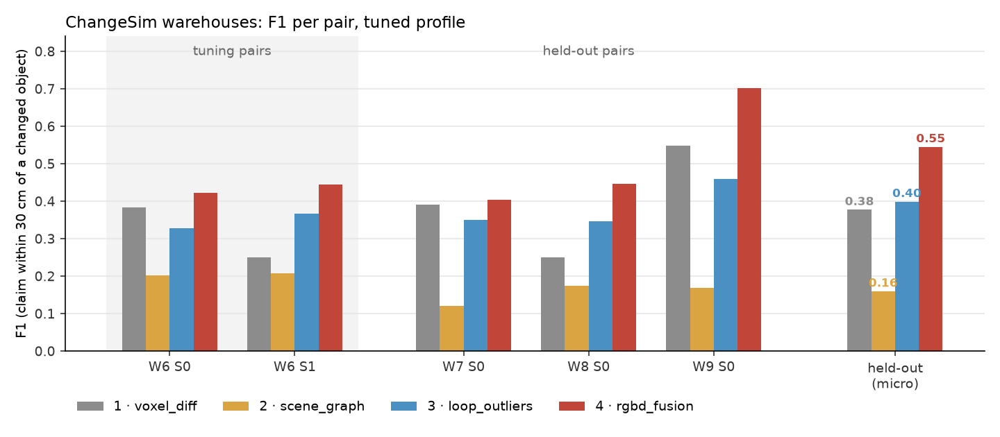
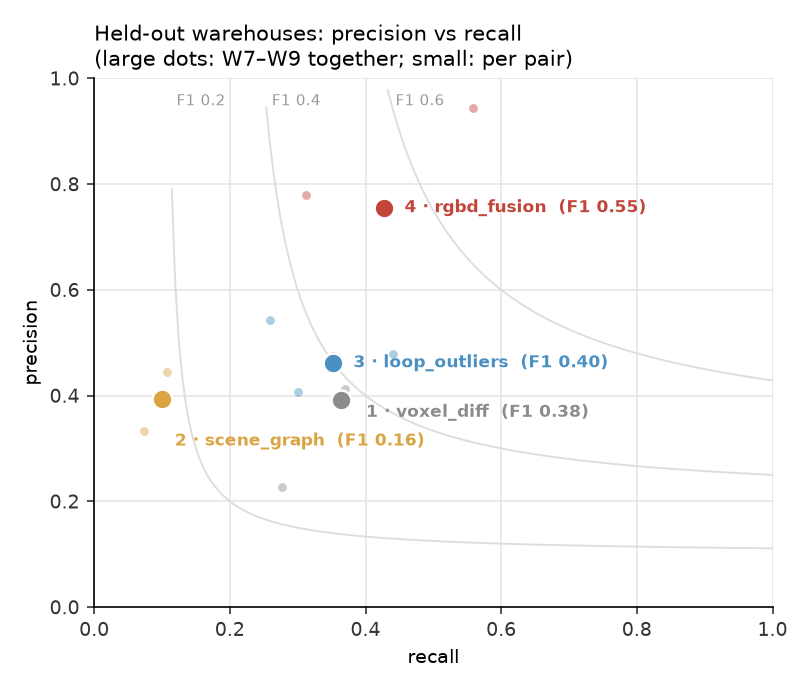

# Benchmark: four approaches, a room and five warehouses

Our recordings show one room with three staged changes. That is enough to develop on,
but not to compare four approaches or to show that one design works in a different kind of space.
So every approach was also run, unchanged apart from its scale profile ([`profiles.md`](profiles.md)),
on five pairs of recordings from a public change-detection dataset, and scored automatically.

## Data

**The room**: our two phone recordings of one room, with three staged changes: the trolley bag
turned perpendicular to the wall, the office chair moved away from the table, the tower fan moved
near the table. The `room` profile is used.

**ChangeSim** ([Park et al., IROS 2021](https://github.com/SAMMiCA/ChangeSim)): photo-realistic
simulated warehouses with RGB-D, camera poses and per-pixel change masks (new, missing, rotated,
replaced). 3RScan, the real-scan alternative, requires an access request, so it was not used.
Each pair is a reference run ("before") and a query run ("after") of one warehouse sequence:

| pair | warehouse | used for | changed objects |
|---|---|---|---|
| W6_S0 | 6, sequence 0 | tuning | 74 |
| W6_S1 | 6, sequence 1 | tuning | 83 |
| W7_S0 | 7, sequence 0 | held out | 54 |
| W8_S0 | 8, sequence 0 | held out | 83 |
| W9_S0 | 9, sequence 0 | held out | 102 |

The `large_space` profile is chosen automatically: the camera paths span 18–32 m. Each pair is
converted to the phone-export layout by [`benchmarks/changesim/convert.py`](../benchmarks/changesim/convert.py).
The query run is moved by a known rigid transform, so every approach has to register the two runs
itself.

- **Ground truth**: changed pixels are lifted to 3D and grouped into objects (connected 10 cm
  voxels, seen in ≥ 3 frames).
- **Depth**: 16-bit in the reference run. The query run stores 8-bit depth (about 20 cm steps),
  which every depth-using approach has to tolerate.

## Scoring

[`benchmarks/evaluate.py`](../benchmarks/evaluate.py), the same for every approach:

- A **claim** is one reported change at one place. A move has two places, its old and new
  position, and counts as correct if either one is right.
- A claim is **correct** when it lies inside, or within 30 cm of, a changed object's box, in the
  recording where that object is. Claims on unchanged objects are wrong.
- **Precision** = correct claims / claims. **Recall** = changed objects hit by at least one claim /
  changed objects. **F1** combines the two. Totals are micro-averaged over pairs.
- The change type (moved / removed / added / rotated) is reported separately. The score only asks
  whether a change was found at the right place.

## Protocol

1. **First design (v1)**: each approach's large-space values, chosen from the scale of the space
   before any ChangeSim result was seen.
   - Approach 1: all five pairs ran in v1, so v1 vs tuned is shown everywhere.
   - Approaches 2 and 3: v1 was scored in their tuning trials (the "first design" rows below). The
     final runs use the tuned values. Approach 3's trials score only its mining stage, which is
     faster but rougher, so its trial F1 differs from the full pipeline's: W6_S1 is 0.28 in the
     kept trial and 0.37 in the final run. Its trial log also holds one check on held-out W7_S0
     (`heldout_v1`, `heldout_tuned`), run after its tuning was fixed; it was not used to choose
     values.
   - Approach 4: v1 is its design before its own tuning. Its base stages already used approaches
     2 and 3's tuned values. Its tuning changed only the fuse rules, so its tuned results reuse the
     v1 runs' earlier stages and re-run fuse and package (`final_eval.py --reuse v1`).
2. **Tuning** on W6_S0 and W6_S1 only. Each approach's tuning script
   (`benchmarks/tune_a1.py` … `tune_a4.py`) changes one group of values per trial and logs it to
   `benchmarks/results/a*_trials.jsonl`. A value is kept only if it helps on both tuning pairs.
3. **Held-out check** on W7_S0, W8_S0, W9_S0 with the tuned values, unchanged.
4. The room is run with the `room` profile, whose values equal the code's defaults
   (`python -m navdelta.config --check`).
5. **One fix after tuning.** The scene graphs' SAM-grid segments are named zero-shot. Their
   vocabulary used to include the Florence-2 names seen in the same 50-frame detection chunk, so a
   name could depend on which frames were detected together. It is now fixed to ScanNet200.
   Approaches 2 and 4 were re-run from fresh 2D detections on every pair and on the room. Their
   tuning trials, run before the fix, were not repeated.

Every run records its stages, run time and peak GPU memory. Hardware: one RTX 3050 Laptop GPU
(4 GB) and a 16-thread laptop CPU. The GPU ran one job at a time, so some stages ran on the CPU and
their times are upper bounds.

## Results

In short:

- **Approach 4 (`rgbd_fusion`) is the most accurate.** On the three held-out warehouses its
  micro-averaged F1 is **0.55**: precision 0.76 and recall 0.43. The next best are approach 3 at
  0.40, approach 1 at 0.38 and approach 2 at 0.16. It has the best F1 on each of the five pairs
  and the highest precision overall. Approach 3 is more precise on two pairs, but finds less.
- **Its tuning generalises.** Approaches 1, 3 and 4 score as well or better on the held-out pairs
  as on the tuning pairs. Approach 4's single tuned rule (no veto in a large space) raised the
  held-out F1 from 0.50 to 0.55. Approach 1's (match fragments from 20 cm) raised it from 0.35 to
  0.38, though not on every pair: W8 went from 0.26 to 0.25.
- **The approaches differ by change type.** Approach 4 finds the most added (58 %), rotated
  (46 %) and replaced (57 %) objects. Approach 1, which carves free space through voxels, finds
  the most removed ones (30 % against approach 4's 25 %).
- **Fusion pays off where the parts disagree.** The scene graph alone (approach 2) has 0.18 F1
  and the outliers alone (approach 3) 0.38. Measured depth plus end-by-end fusion of the two
  reaches 0.50 over all five pairs, mostly by keeping what both detectors agree on.
- **On the room**, every approach finds the three staged changes, each as a move with both
  places right. Approach 3 reports nothing else. Approaches 2 and 4 each report one false change:
  a divider "removed", and a shelf "added" beside a mirror. Approach 1 reports 5 more changes,
  such as a chest of drawers pushed ~0.2 m; they are not in the staged list, so they could not be
  checked.

<!-- tables:start -->
### ChangeSim: tuned profile, micro-averaged

| Approach | Tuning pairs (W6) P / R / F1 | Held-out pairs (W7–W9) P / R / F1 | All pairs F1 | Claims | Changes found |
|---|---|---|---|---|---|
| 1 · voxel_diff (LiDAR voxels) | 0.39 / 0.26 / **0.31** (2) | 0.39 / 0.36 / **0.38** (3) | 0.35 | 415 | 128/396 |
| 2 · scene_graph (RGB) | 0.38 / 0.14 / **0.21** (2) | 0.39 / 0.10 / **0.16** (3) | 0.18 | 103 | 46/396 |
| 3 · loop_outliers (RGB) | 0.55 / 0.25 / **0.35** (2) | 0.46 / 0.35 / **0.40** (3) | 0.38 | 259 | 124/396 |
| 4 · rgbd_fusion (RGB-D) | 0.66 / 0.32 / **0.43** (2) | 0.76 / 0.43 / **0.55** (3) | 0.50 | 230 | 153/396 |

(n) = number of pairs scored.

### ChangeSim: run time per pair (tuned, minutes)

Wall time of the scored run on one laptop (RTX 3050 4 GB, 16 threads), shared with other jobs. G = models on the GPU, C = models on the CPU. voxel_diff: its whole pipeline (alignment to package). The other three build on the shared RGB reconstruction, listed first (2 and 3 use it, 4 reuses its MASt3R matches); each approach's row is its time after it. scene_graph's includes the 2D detections (Florence-2, SAM 2.1, SigLIP 2 on every keyframe), which rgbd_fusion reuses; rgbd_fusion's includes its own RGB-D reconstruction.

| Stage / approach | W6_S0 | W6_S1 | W7_S0 | W8_S0 | W9_S0 |
|---|---|---|---|---|---|
| shared: RGB reconstruction (MASt3R) | 28 G | 29 G | 25 G | 27 G | 33 G |
| 1 · voxel_diff (LiDAR voxels) | 51 G | 108 G | 116 G | 93 G | 47 G |
| 2 · scene_graph (RGB) | 48 G | 46 G | 35 G | 39 G | 41 G |
| 3 · loop_outliers (RGB) | 26 C | 78 C | 6 G | 113 C | 25 G |
| 4 · rgbd_fusion (RGB-D) | 27 C | 25 C | 33 C | 34 C | 27 C |

### ChangeSim: F1 per pair (tuned; first design in brackets)

| Approach | W6_S0 (tuning) | W6_S1 (tuning) | W7_S0 | W8_S0 | W9_S0 |
|---|---|---|---|---|---|
| 1 · voxel_diff (LiDAR voxels) | 0.38 (0.30) | 0.25 (0.24) | 0.39 (0.36) | 0.25 (0.26) | 0.55 (0.44) |
| 2 · scene_graph (RGB) | 0.20 | 0.21 | 0.12 | 0.17 | 0.17 |
| 3 · loop_outliers (RGB) | 0.33 | 0.37 | 0.35 | 0.35 | 0.46 |
| 4 · rgbd_fusion (RGB-D) | 0.42 (0.40) | 0.45 (0.42) | 0.40 (0.27) | 0.45 (0.43) | 0.70 (0.66) |

### ChangeSim: before vs after tuning (micro F1)

| Approach | Tuning pairs: first design → tuned | Held-out pairs: first design → tuned |
|---|---|---|
| 1 · voxel_diff (LiDAR voxels) | 0.26 → **0.31** (2) | 0.35 → **0.38** (3) |
| 2 · scene_graph (RGB) | – | – |
| 3 · loop_outliers (RGB) | – | – |
| 4 · rgbd_fusion (RGB-D) | 0.41 → **0.43** (2) | 0.50 → **0.55** (3) |

### ChangeSim: registration of the two runs (tuned)

Median position error of the second run's cameras against the ground truth, after the approach put both runs into one frame (cm). It includes how far the pose graph bent the first run. scene_graph and loop_outliers share one reconstruction.

| Approach | W6_S0 | W6_S1 | W7_S0 | W8_S0 | W9_S0 |
|---|---|---|---|---|---|
| 1 · voxel_diff (LiDAR voxels) | 18 | 70 | 75 | 82 | 17 |
| 2 · scene_graph (RGB) | 12 | 32 | 60 | 44 | 23 |
| 3 · loop_outliers (RGB) | 12 | 32 | 60 | 44 | 23 |
| 4 · rgbd_fusion (RGB-D) | 31 | 50 | 56 | 32 | 36 |

### ChangeSim: recall by type of change (tuned, all pairs)

| Approach | removed | added | rotated | replaced |
|---|---|---|---|---|
| 1 · voxel_diff (LiDAR voxels) | 0.30 (210) | 0.33 (72) | 0.37 (54) | 0.37 (60) |
| 2 · scene_graph (RGB) | 0.08 (210) | 0.28 (72) | 0.09 (54) | 0.08 (60) |
| 3 · loop_outliers (RGB) | 0.20 (210) | 0.46 (72) | 0.35 (54) | 0.48 (60) |
| 4 · rgbd_fusion (RGB-D) | 0.25 (210) | 0.58 (72) | 0.46 (54) | 0.57 (60) |

(n) = changed objects of that type in the scored pairs.

### Tuning trials (tuning pairs only)

Each trial changes a few large-space values; F1 per tuning pair and micro-averaged over both. **kept** marks the values in `large_space.toml`.

**1 · voxel_diff (LiDAR voxels)**

| Values changed | W6_S0 F1 | W6_S1 F1 | Both (micro F1) | |
|---|---|---|---|---|
| first design | 0.30 | 0.24 | 0.26 |  |
| MIN_REGION_VOXELS = 5 | 0.32 | – | – |  |
| FRAGMENT_MAX_VOXELS = 8 | 0.38 | 0.25 | 0.31 | **kept** |
| CARVE_MARGIN_M = 0.15, CARVE_MARGIN_PER_M = 0.015 | 0.30 | – | – |  |
| DEPTH_MAX_M = 16.0 | 0.32 | – | – |  |
| DEPTH_MAX_M = 16.0, FRAGMENT_MAX_VOXELS = 8, MIN_REGION_VOXELS = 5 | 0.38 | – | – |  |
| DEPTH_MAX_M = 16.0, FRAGMENT_MAX_VOXELS = 4, MIN_REGION_VOXELS = 5 | 0.39 | 0.26 | 0.32 |  |
| DEPTH_MAX_M = 20.0, FRAGMENT_MAX_VOXELS = 8, MIN_REGION_VOXELS = 5 | 0.37 | – | – |  |
| DEPTH_MAX_M = 16.0, FRAGMENT_MAX_VOXELS = 8 | – | 0.25 | – |  |

**2 · scene_graph (RGB)**

| Values changed | W6_S0 F1 | W6_S1 F1 | Both (micro F1) | |
|---|---|---|---|---|
| first design | 0.18 | 0.13 | 0.15 |  |
| GONE_MIN = 0.5 | 0.18 | – | – |  |
| SEE_PAST_M = 0.1, SEE_PAST_PER_M = 0.01, SURFACE_M = 0.1, SURFACE_PER_M = 0.01 | 0.19 | – | – |  |
| MIN_CHANGE_OBS = 2 | 0.20 | 0.19 | 0.20 |  |
| MIN_CHANGE_SIZE_M = 0.2 | 0.18 | – | – |  |
| MIN_CHANGE_OBS = 2, MIN_OBSERVATIONS = 1 | 0.21 | 0.21 | 0.21 | **kept** |
| MERGE_SIZE_RATIO = 1.5 | 0.12 | – | – |  |

**3 · loop_outliers (RGB)**

| Values changed | W6_S0 F1 | W6_S1 F1 | Both (micro F1) | |
|---|---|---|---|---|
| OUTLIER_M = 0.4, OUTLIER_PER_M = 0.0 | 0.22 | 0.24 | 0.23 |  |
| first design | 0.27 | 0.22 | 0.25 |  |
| OUTLIER_PER_M = 0.08 | 0.26 | 0.23 | 0.24 |  |
| MIN_EVIDENCE = 40 | 0.27 | 0.22 | 0.25 |  |
| MIN_MATCHES = 50 | 0.28 | 0.24 | 0.26 |  |
| RANSAC_M = 0.1 | 0.28 | 0.25 | 0.26 |  |
| MIN_MATCHES = 50, RANSAC_M = 0.1 | 0.28 | 0.26 | 0.27 |  |
| MIN_MATCHES = 50, RANSAC_M = 0.12 | 0.28 | 0.23 | 0.26 |  |
| MIN_MATCHES = 50, OUTLIER_PER_M = 0.06, RANSAC_M = 0.1 | 0.31 | 0.25 | 0.28 |  |
| MIN_MATCHES = 40, RANSAC_M = 0.1 | 0.28 | 0.24 | 0.26 |  |
| CELL_M = 0.15, MIN_MATCHES = 50, RANSAC_M = 0.1 | 0.33 | 0.28 | 0.30 | **kept** |
| CELL_M = 0.15, MIN_MATCHES = 50, OUTLIER_PER_M = 0.06, RANSAC_M = 0.1 | 0.31 | 0.25 | 0.28 |  |
| CELL_M = 0.2, MIN_MATCHES = 50, RANSAC_M = 0.1 | 0.28 | 0.26 | 0.27 |  |

**4 · rgbd_fusion (RGB-D)**

| Values changed | W6_S0 F1 | W6_S1 F1 | Both (micro F1) | |
|---|---|---|---|---|
| first design | 0.40 | 0.41 | 0.41 |  |
| fuse.GRAPH_ALONE_EMPTY = 0.7 | 0.40 | – | – |  |
| fuse.GRAPH_ALONE_EMPTY = 0.8 | 0.40 | – | – |  |
| fuse.GRAPH_ALONE_OBS = 3 | 0.40 | – | – |  |
| fuse.GRAPH_ALONE_ROTATED = False | 0.41 | 0.38 | 0.39 |  |
| fuse.GRAPH_ALONE_SEM = 0.85 | 0.40 | – | – |  |
| fuse.ALONE_MIN_MATCHES = 30, fuse.ALONE_MIN_PAIRS = 2 | 0.39 | – | – |  |
| fuse.ALONE_MIN_MATCHES = 100 | 0.41 | 0.41 | 0.41 |  |
| fuse.VETO_PRESENT = 0.3 | 0.39 | – | – |  |
| fuse.VETO_PRESENT = 1.01 | 0.42 | 0.45 | 0.43 | **kept** |
| fuse.ASSOC_M = 0.5 | 0.40 | – | – |  |
| fuse.ASSOC_SHARE = 0.15 | 0.40 | – | – |  |
| fuse.ALONE_MIN_MATCHES = 1000000, fuse.GRAPH_ALONE_EMPTY = 1.01 | 0.35 | – | – |  |
| diff.GONE_MIN = 0.5 | 0.41 | – | – |  |
| fuse.ASSOC_M = 0.3 | 0.40 | 0.41 | 0.41 |  |
| fuse.VETO_PRESENT = 0.8 | 0.42 | 0.40 | 0.41 |  |
| fuse.ALONE_MIN_MATCHES = 80 | 0.41 | 0.41 | 0.41 |  |
| fuse.ALONE_MIN_PAIRS = 6 | 0.40 | 0.41 | 0.41 |  |
| fuse.ALONE_MIN_MATCHES = 100, fuse.VETO_PRESENT = 1.01 | 0.43 | 0.44 | 0.43 |  |
| fuse.ALONE_MIN_MATCHES = 100, fuse.GRAPH_ALONE_ROTATED = False, fuse.VETO_PRESENT = 1.01 | 0.44 | 0.41 | 0.42 |  |
| fuse.ALONE_MIN_MATCHES = 100, fuse.VETO_PRESENT = 0.8 | 0.42 | 0.41 | 0.42 |  |
| diff.MIN_CHANGE_OBS = 1 | 0.41 | – | – |  |

### Our room (3 staged changes)

| Approach | Staged changes found | Reported as moved with both places right | Extra claims |
|---|---|---|---|
| 1 · voxel_diff (LiDAR voxels) | 3/3 | 3/3 | 5 |
| 2 · scene_graph (RGB) | 3/3 | 3/3 | 1 |
| 3 · loop_outliers (RGB) | 3/3 | 3/3 | 0 |
| 4 · rgbd_fusion (RGB-D) | 3/3 | 3/3 | 1 |

<!-- tables:end -->

## Reading the numbers

- **A warehouse is not a room.** Most ChangeSim changes are boxes and small items on racks,
  20–60 cm across, seen from 3–15 m away, many of them in only a few frames. No approach finds
  more than 60 % of them on any pair. The comparison between approaches is the useful result,
  not the absolute level.
- **The change type** is reported but not scored. ChangeSim's "replaced" (one object swapped for
  another) and "rotated" have no exact counterpart in the approaches' outputs.
- **Reproduce** with the scripts in [`benchmarks/`](../benchmarks/README.md): `prepare.py`
  downloads and converts the pairs and runs the shared stages, `final_eval.py` scores one approach
  and profile, `room_score.py` scores the room, and `final_report.py` rebuilds these tables. Every
  scored run is a line of `benchmarks/results/final.jsonl`.
