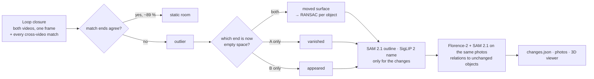

# Approach 3 – `loop_outliers`: changes are the outliers of the loop closure

SLAM recognises a place it has seen before and closes the loop: feature matches between the old
and the new view pull the map together. Robust SLAM **throws away** the matches that do not fit —
often exactly the things that moved since. This approach closes one large loop between video A and
video B and **keeps what SLAM throws away**: the outlier matches are the changes.

Code: [`navdelta/approaches/loop_outliers/`](../navdelta/approaches/loop_outliers/) ·
input: the shared reconstruction ([`reconstruction.md`](reconstruction.md)), whose pose graph is
the loop closure · run: `navdelta run --approach loop_outliers` (or `./run.sh loop_outliers`).

## Step 1 – Mine the outliers (`mine.py`, seconds)

Every MASt3R match between a keyframe of A and a keyframe of B claims "this surface in A is that
surface in B". Both ends are lifted to 3D in the common frame:

- **inlier** (static): the ends agree within max(10 cm, 3 % of depth) — 89 % of 179 000 matches on
  our room recordings, median disagreement 2.5 cm;
- **outlier**: the ends are more than 25 cm apart (plus a share of the depth in large spaces).

Each outlier is explained by checking **both of its ends against the other video's depth**:

| A's end is now empty space | B's end was empty space | meaning |
|---|---|---|
| yes | yes | the same surface sits somewhere else → **moved** |
| yes | no | the surface vanished (MASt3R matched it to the background now visible) → **removed** evidence |
| no | yes | → **added** evidence |
| no | no | a mismatch → discarded |

Moved matches go to **sequential RANSAC**: each rigid motion (turn about gravity + shift) that
≥ 25 matches from ≥ 2 view pairs agree on is one moved object. Its distance and **turn come from
its own matched features**, so an object turned in place is measured directly (the trolley bag:
80°). Removed / added evidence is grouped into objects (connected 10 cm cells); pieces within
50 cm of a moved object are part of it (a chair's seat when its back carried the matches).

## Step 2 – Segment and name only the changes (`segment.py`)

For each change, in the 1–2 views holding most of its outlier matches, **SAM 2.1** is prompted
with up to six well-spread outlier pixels; the outline is lifted to 3D for the object's real
extent and named by **SigLIP 2** (masked crop, ScanNet200 classes). Then:

- a removed and an added change that look alike (SigLIP ≥ 0.75, similar size) are **one object
  moved** between places no single view pair showed together (the fan: 0.74 m);
- reflections (mirror, window, glass, screens) are not objects and are dropped;
- a removed / added change nobody corroborates needs strong evidence (≥ 60 matches from ≥ 4 view
  pairs) — three weak "appeared" changes near the bathroom mirror are dropped this way.

## Step 3 – Where it is (`context.py`)

A change is easier to act on with a reference: *"next to the desk"*. Only the 1–2 photos already
used to outline each end of a change are looked at, so this stays fast:

- **Florence-2 + SAM 2.1** find the objects around the change in those photos; each is lifted to
  3D with the photo's depth.
- **Landmark check**: a neighbour counts only if the *other* video still sees a surface where it is.
  A thing that moved too is no reference.
- **Relations**: "on" (resting on it) and "next to" (gap under 30 cm). For a moved object, also how
  its distance to a landmark seen at both ends changed.

The sentences in `changes.json` and `CHANGE_REPORT.md` are rewritten with them.

## Step 4 – Package (`package.py`)

`changes.json` ([schema](changes-schema.md)) with the evidence of every change (matches, view
pairs, look-alike similarity), `CHANGE_REPORT.md`, before/after photos, the shared 3D viewer.

## Results on our room recordings

| Staged change | Reported |
|---|---|
| trolley bag turned perpendicular to the wall | **luggage moved 0.54 m and turned 80°** (437 of its own matches, 9 view pairs) |
| office chair moved away from the table | **chair moved 0.51 m** (101 matches, 6 view pairs) |
| tower fan moved near the table | **fan moved 0.74 m** (vanished + appeared, look-alike 0.88) |
| other reported changes | none |

Run time on the shared reconstruction (RTX 3050, 4 GB): mining **2 s**, segmentation 22 s,
context 24 s, package 3 s (about 3 min each for segmentation and context on the CPU). The expensive part is the shared reconstruction (18 min); no whole-scene
detection is needed.

## How it differs from the other approaches

| | `voxel_diff` | `scene_graph` | `loop_outliers` | `rgbd_fusion` |
|---|---|---|---|---|
| evidence for a change | free space carved through LiDAR voxels | object nodes matched between graphs | matches the loop closure rejects | both of the previous two, on sensor depth, fused |
| needs depth maps | yes | no | no | yes |
| runs detectors on | changed regions | every keyframe | only the changed objects | every keyframe + the changed objects |
| motion of a moved object | shape fit of old vs new voxels | centroid of the nodes | its own feature matches (distance + turn) | its own feature matches when the outliers found it, else node centroids |

Approach 4 ([`rgbd_fusion.md`](rgbd_fusion.md)) runs this approach's mining and segmentation on the
recording's measured depth and uses the scene graph to confirm or veto what it finds.

How this differs from existing change detection, with references: [`related_work.md`](related_work.md).

## Limitations

- An object is only found if MASt3R matched it across the videos (both videos must have seen it
  from views SigLIP paired up), or if enough of it vanished / appeared.
- Depth error grows with range: in large spaces the outlier threshold grows with depth, and only
  changes of 30 cm and more are reliable.
- Weak, uncorroborated evidence is dropped on purpose: a small object that disappeared and was
  seen in only one or two view pairs is missed.
- MASt3R's licence is non-commercial (see [`licences.md`](licences.md)).
