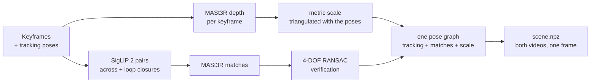

# Shared reconstruction – RGB + phone tracking, one pose graph for both videos

Used by approach 2 (`scene_graph`) and approach 3 (`loop_outliers`). It needs only what every
phone recording has: **RGB keyframes and the phone's own tracking poses** (ARKit / ARCore). No
LiDAR depth, no mesh, no Polycam post-processing. (Approach 1 uses the LiDAR alignment in
[`alignment.md`](alignment.md) instead.)

Code: [`navdelta/recon/reconstruct.py`](../navdelta/recon/reconstruct.py) · run alone with
`navdelta reconstruct` · output: `<outputs>/recon/`.

## Why not simpler

| Tried | Result on our room recordings | Why it failed |
|---|---|---|
| MASt3R's own global alignment of all keyframes (RGB only) | camera error 0.24–0.9 m, sometimes flipped | keyframes are ~1 s apart; blank walls break the chain |
| phone tracking + **one** rigid transform between the videos | parts of the room 17–22 cm apart | each recording's tracking drifts on its own (10–30 cm across a room) |
| pose graph with 3D point-distance residuals | depth scale shrank 4 %, depth error doubled | shrinking all depth lowers point distances: a biased cost |

## Steps

1. **Keyframes.** Frames with almost no texture (Laplacian variance < 100: blank wall, ceiling)
   are skipped; every 2nd remaining keyframe is used.
2. **Depth.** Each keyframe is paired with a neighbour about 0.3 m away (similar view direction).
   MASt3R's dense point map gives the *shape* of the depth; its matches, triangulated with the
   two tracked poses (parallax > 2°, reprojection < 2 px), fix the *metric scale* per frame.
   A pixel is kept only if a neighbouring keyframe's depth agrees with it (5 cm or 5 %).
3. **Pairs.** SigLIP 2 image embeddings pick, for every keyframe, the two most similar
   keyframes of the other video and one of its own video outside a 20-frame window (loop closure).
4. **Verification.** Every pair's MASt3R matches are lifted to 3D and must agree on one rigid
   motion with gravity fixed (yaw + translation; 4-DOF RANSAC, 8 cm). This rejects mismatches and
   matches on objects that moved — they must not pull the videos together.
5. **Pose graph.** One least-squares problem over every keyframe of both videos
   (pose: 6 parameters, depth scale: 1):
   - the tracking's frame-to-frame motion as odometry (1 cm + 3 % of the step, 0.3°),
   - every verified match as a **reprojection** error both ways (3 px) — unlike 3D distances it
     cannot be lowered by shrinking the depth,
   - gravity from the IMU (roll / pitch kept to 0.5°), depth scale near the triangulated one (5 %),
   - robust loss (soft L1), so a few bad matches do not bend the solution.
   Every 5th verified cross-video pair is **held out** and used only to grade the result.
6. **Floor.** The densest horizontal layer below the cameras becomes z = 0.

## Results on our room recordings (84 + 86 keyframes, RTX 3050 4 GB)

| | before the pose graph | after |
|---|---|---|
| held-out cross-video matches, median disagreement | 13.5 cm | **2.6 cm** (90 % < 7.4 cm) |
| loop closures, median disagreement | 14.7 cm | **2.2 cm** |
| depth vs the phone's LiDAR (never used) | | **3.6 cm** median (3.1 %) |

Run time 18 min (MASt3R on ~430 pairs). On the ChangeSim warehouses (tens of metres across)
the held-out agreement is 4–13 cm: 9.3, 8.7, 4.1 and 12.7 cm on W6_S0, W6_S1,
W7_S0 and W8_S0 (see [`benchmark.md`](benchmark.md)).

## RGB-D variant (approach 4)

`navdelta reconstruct-rgbd` ([`reconstruct_rgbd.py`](../navdelta/recon/reconstruct_rgbd.py))
runs the same pose graph with the recording's **own depth maps** instead of MASt3R depth, as
RGB-D SLAM does. Output: `<outputs>/recon_rgbd/`, with the same files.

- **Depth**: the depth keyframes (`corrected_depth/<frame>.Clean.png`, millimetres), 0.25–5 m in a
  room and 0.25–12 m in a large space. Pixels on depth edges are dropped: a 3 × 3 patch spanning
  more than 5 cm + 2 % mixes foreground and background ("flying pixels"). In a large space the
  threshold is 20 cm + 2 %.
- **Scale**: measured, so it is held fixed (1 % prior instead of 5 %).
- **Matches**: MASt3R is still the matcher. When `<outputs>/recon/` exists (same keyframes), its
  cross-video and loop-closure matches are reused and no network runs. Otherwise MASt3R computes
  the matches; MASt3R depth is never computed.
- **Verification**: 3D–3D RANSAC at 5 cm instead of 8 cm (10 cm in a large space), because
  measured depth allows it.

| | MASt3R depth | sensor depth |
|---|---|---|
| room: held-out cross-video matches, median | 2.6 cm | **1.9 cm** (90 % < 5.6 cm) |
| room: run time | 18 min | 2 min (matches reused) |
| ChangeSim, held-out cross-video matches, median: W6_S0 / W6_S1 / W7_S0 / W8_S0 / W9_S0 | 9.3 / 8.7 / 4.1 / 12.7 / 18.3 cm | **5.3 / 5.3 / 4.9 / 5.5 / 5.5 cm** |

Tighter internal agreement does not always mean a better absolute registration. Against
ChangeSim's ground-truth cameras, the RGB-D graph is better on W8 (32 vs 44 cm) and W7, but worse
on W6 and W9. With measured depth and a fixed scale, the graph bends the first run a little
differently (see [`benchmark.md`](benchmark.md)).

## Outputs (`<outputs>/recon/`)

| File | Content |
|---|---|
| `scene.npz` | per keyframe: name, recording, camera-to-world pose (common frame, Z up, floor at 0), intrinsics, metric depth and confidence (512 × 384), RGB |
| `cross_matches.npz` | every MASt3R match between a keyframe of each video (approach 3 mines its outliers) |
| `depth_<recording>.npz`, `loop_matches_<recording>.npz` | caches: a rerun skips MASt3R |
| `recon_report.json` | profile, pairs, residuals before / after, depth-scale corrections, run time |

Reproducibility: run twice from scratch on the room, the stage gives bit-identical camera poses
and depth maps, so the recorded residuals (2.6 cm held out) and floor height reproduce exactly.

MASt3R's code is fetched once at a pinned commit (see
[`navdelta/recon/mast3r_src.py`](../navdelta/recon/mast3r_src.py)); its licence is
non-commercial (CC BY-NC-SA 4.0, see [`licences.md`](licences.md)).
