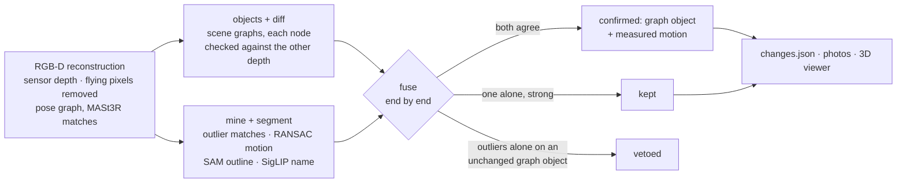

# Approach 4 – `rgbd_fusion`: scene graphs + loop-closure outliers on measured depth

Approaches 2 and 3 see the room through MASt3R's predicted depth and fail in opposite ways:

- **The scene graph** (approach 2) knows *what* the objects are, their whole outlines and their
  relations, but its evidence for motion is coarse: node centroids.
- **The loop-closure outliers** (approach 3) measure *how* a thing moved from its own features,
  including the turn. But they only see the parts that MASt3R matched across the videos, and
  they cannot tell an object from a reflection or a wall corner.

Approach 4 runs both detectors on the **recording's own depth maps** (phone LiDAR, ToF or a
simulator), the way RGB-D SLAM does. It then **fuses** them, the way semantic RGB-D SLAM fuses
instance masks with multi-view geometry.

Code: [`navdelta/approaches/rgbd_fusion/`](../navdelta/approaches/rgbd_fusion/) · input: the
RGB-D reconstruction (`navdelta reconstruct-rgbd`, below) · run:
`navdelta run --approach rgbd_fusion` (or `./run.sh rgbd_fusion`).

## What it takes from RGB-D SLAM

| RGB-D SLAM practice | where it comes from | here |
|---|---|---|
| every keypoint carries a **measured depth** | ORB-SLAM2/3 (RGB-D mode), RTAB-Map | the pose graph, the scene graph and the outlier test all use the sensor depth; no depth network, no scale estimation |
| drop **depth-edge ("flying") pixels** | RGB-D front ends, KinectFusion | a 3 × 3 patch whose depth spans more than 5 cm + 2 % is untrusted |
| **range-dependent noise gates** (χ² test with σ(z) = a + b·z) | ORB-SLAM's outlier rejection | inlier: ends agree within max(6 cm, 2 % of depth). Seen through / still there: 8 cm + 1 cm per metre, instead of 10 cm. The outlier gate stays at 25 cm (below) |
| **3D–3D RANSAC** with tight inlier distances | RTAB-Map loop-closure verification | cross-video pair verification at 5 cm; one rigid motion per moved object at 5 cm |
| **multi-view depth consistency** finds what moved | DynaSLAM | each end of an outlier match, and each scene-graph node, is projected into the other video's depth maps: seen through = gone from there |
| **object-level motion** | Co-Fusion, MID-Fusion | sequential RANSAC on the moved matches: each object gets its own yaw + translation |
| **semantic + geometric fusion** | DynaSLAM, MaskFusion | the fuse stage, below |

One RGB-D idea did not hold up: a tighter outlier gate, so that smaller moves count. With 15 cm
instead of 25 cm, the room produced 15 outlier candidates instead of 6. Phone LiDAR depth is
256 × 192 and smoothed at object borders, so match ends 15–25 cm apart are mostly border noise,
not motion. The gate stays at 25 cm.

The feature matcher stays MASt3R rather than ORB. ORB keypoints are sparse on the textureless
furniture and walls of a room, and MASt3R's dense matches survive the large viewpoint changes
between two separate recordings. When the RGB reconstruction has already run, its matches are
reused (`<outputs>/recon`), so the RGB-D reconstruction takes about 2 minutes.

## Stages

| # | stage | what it does |
|---|---|---|
| 0 | `reconstruct-rgbd` (shared) | the pose graph of [`reconstruction.md`](reconstruction.md) on sensor depth: tracking odometry + match reprojections + gravity, scale held fixed |
| 1 | `objects` | approach 2's detectors (Florence-2, SAM 2.1 + point grid, SigLIP 2), lifted with sensor depth into scene-graph nodes and "on" / "next to" edges. The 2D detections are reused when approach 2 ran on the same keyframes |
| 2 | `diff` | each node checked against the other video's depth: present / seen through / unseen; gone and appeared nodes paired by appearance into moves |
| 3 | `mine` | approach 3's loop-closure outliers with the RGB-D gates above |
| 4 | `segment` | SAM 2.1 outline and SigLIP 2 name per outlier change. Nothing is dropped for weak evidence here: the fuse stage decides |
| 5 | `fuse` | association and decision (below) |
| 6 | `package` | `changes.json`, before/after photos, the shared 3D viewer |

## The fuse stage

Every change of either detector has a **before end** (where the object was) and/or an **after
end** (where it is now). A move has both. An outlier change belongs to the scene-graph change
whose object holds most of its outline: at least 30 % of its 3D points lie within 15 cm (50 cm in
a large space) of the object's voxels, end by end, in the same recording. One outlier move can
join a graph "removed" at X and a graph "added" at Y into one move X → Y. Otherwise each outlier
change joins at most one graph change. A first version linked changes whenever their boxes came
close. On the room, that let one large outline chain the fan and the luggage into a single change.

Some outlier "moves" are only look-alike pairings: something vanished at X, and something similar
appeared at Y. These are not measured from the object's own features. If only one end of such a
pairing lies on a graph object, it is split: that end corroborates the graph object, and the
other end becomes a candidate of its own. In a warehouse full of identical boxes, the pairing
itself is unreliable, but each end can still be a real change. On W6_S0 this raised F1 from 0.39
to 0.40, and it stopped a removed pipe from being reported as "moved" to where a box appeared.

| cluster | decision | what is reported |
|---|---|---|
| both detectors | **confirmed** | the graph's object (whole outline, name voted over all its views, relations) with the outliers' measured distance and turn |
| scene graph only | kept if its own evidence is strong enough (share seen through, number of views, look-alike score) | as approach 2 |
| outliers only | kept if strong (≥ 60 matches from ≥ 4 view pairs, or a RANSAC move), **unless** the graph sees an unchanged object covering it (veto; off in a large space, see below) | as approach 3, with relations computed against the graph's nodes |

A change only one detector found is also dropped when it is on or next to a mirror, a window or
glass. Depth sensors see through them (or into the reflection), so the depth there shows empty
space that is not empty. This is a known failure of RGB-D sensing. The rule needs the reflective
object to be a node of the scene graph next to the change. On the room, the false "shelf added"
beside the bathroom mirror is dropped only when the mirror is detected as such a node.

**Tuned for large spaces** on the two tuning pairs (`benchmarks/tune_a4.py`; trials in
[`benchmark.md`](benchmark.md)). Only one rule changed: the veto is off. In a warehouse, racks and
shelves are large scene-graph nodes that stay in place. Boxes taken off them lie on a node that is
"still there", so the veto removed real changes: F1 0.40 / 0.42 → 0.42 / 0.45 on the two tuning
pairs. Other trials made no difference: the association distance, the graph-only thresholds, a
stricter rule for outliers alone, the diff's "gone" share, and reporting nodes seen once. Turning
graph-only turns off was worse on one pair.

Every change in `changes.json` says which detectors found it (`found_by`, `confirmed`) and carries
both detectors' evidence. Everything not reported is listed under `dropped`, with the reason.

## Requirements

Depth maps per keyframe: `<recording>_imgs/keyframes/corrected_depth/<frame>.Clean.png`
(millimetres, as the phone export writes them). `navdelta check-data --approach rgbd_fusion` checks for
them. The depth range is 0.25–5 m in a room (phone LiDAR) and 0.25–12 m in a large space.

## Results on our room recordings

| Staged change | Reported | Found by |
|---|---|---|
| trolley bag turned perpendicular to the wall | **luggage and bags moved 0.55 m, turned ~86°** (from 879 of its own features) | both |
| office chair moved away from the table | **chair moved 0.50 m**; 0.60 → 1.22 m from the desk | both |
| tower fan moved near the table | **fan moved 0.95 m**; now next to the desk, 0.06 m from the television (was 1.33 m) | both |
| other reported changes | **shelf added**: false, beside the bathroom mirror (60 % of it "seen through") | scene graph only |

The outliers alone had one more candidate, a pillow that appeared. It was dropped as weak: 48
matches from 11 view pairs, where 60 from 4 are needed.

These are the results of `navdelta verify` (both runs identical), with every 2D detection
computed from scratch. They reuse approach 2's MASt3R matches. Run standalone in Docker, computing
its own matches, approach 4 found the same three staged moves, all confirmed by both detectors,
plus a paper "moved" (outliers only) and a shelf "removed" and "added" by the mirror (scene graph
only). A run during development dropped the shelf, using 2D detections cached by
an earlier version of the detection stage: there, the scene graph had the mirror as a node next
to the shelf, so the mirror rule applied. In the verified run, the mirror is not a node beside the
shelf, so the rule cannot apply.

Run time on the room (RTX 3050, 4 GB, from the `navdelta verify` run):
- RGB-D reconstruction: 2 min, with the MASt3R matches of `outputs/recon`.
- Scene graphs: 18 min with the 2D detections computed from scratch; 12 s when approach 2's are
  reused.
- Diff 10 s, mining 2 s, segmentation 20 s, fuse < 1 s, package 3 s.

## Results on five warehouses (ChangeSim)

| | W6_S0 | W6_S1 | W7_S0 | W8_S0 | W9_S0 | held-out (W7–W9) |
|---|---|---|---|---|---|---|
| F1, first design | 0.40 | 0.42 | 0.27 | 0.43 | 0.66 | 0.50 |
| F1, tuned (veto off) | **0.42** | **0.45** | **0.40** | **0.45** | **0.70** | **0.55** (P 0.76, R 0.43) |
| best other approach | 0.38 (1) | 0.37 (3) | 0.39 (1) | 0.35 (3) | 0.55 (1) | 0.40 (3) |

W6 pairs were used for tuning; W7–W9 were held out. The RGB-D reconstruction's held-out
cross-video matches agree to 4.9–5.5 cm (median) on all five pairs; the MASt3R reconstruction
gives 4.1–18.3 cm. Full tables, including run times, registration against ground truth and recall
per change type: [`benchmark.md`](benchmark.md).

How this differs from existing change detection, with references: [`related_work.md`](related_work.md).

## Limitations

- It needs depth maps. Without them, use approaches 2 and 3, which predict depth from RGB.
- Phone LiDAR depth is low-resolution (256 × 192, upsampled) and smoothed at edges, so thin
  objects and object borders are uncertain. Both detectors produce some false candidates, and the
  fusion rules remove most of them, but not all: the room's shelf beside the mirror is one.
- Two detectors cost more than one: about the run time of approach 2 plus approach 3's segmentation.
  The 2D detections and the MASt3R matches are shared when those approaches have already run.
- MASt3R's licence is non-commercial (see [`licences.md`](licences.md)).
