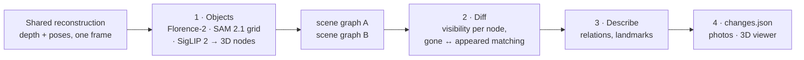

# Approach 2 – `scene_graph`: 3D scene graphs from RGB, compared object by object

Each video becomes a **3D scene graph**: nodes are objects (name, 3D extent, appearance), edges are
relations ("on", "next to"). Change detection compares the two graphs. Every claim is checked
against the other video's depth: an object is only "gone" if the other video **looked at its spot
and saw through it**. Nothing is trained, fine-tuned or labelled by hand.

Code: [`navdelta/approaches/scene_graph/`](../navdelta/approaches/scene_graph/) ·
input: the shared reconstruction ([`reconstruction.md`](reconstruction.md)) ·
run: `navdelta run --approach scene_graph` (or `./run.sh scene_graph`).

## Step 1 – Objects (`objects.py`)

Per keyframe, on the upright image:

- **Florence-2** `<OD>` proposes named boxes; **SAM 2.1** turns each box into a mask.
- Florence-2 has a fixed list of names and **misses things it has no name for** (the tower fan was
  never boxed). So SAM 2.1 is also prompted with a 12 × 9 point grid; segments no Florence-2 mask
  covers are named by **SigLIP 2** zero-shot over the 200 ScanNet200 classes, on a crop with the
  background greyed out (a floor patch next to the fan is otherwise called "fan").
- Each mask is lifted to 3D with that keyframe's depth (edges eroded, depth outliers cut, the
  largest connected piece kept) and embedded with SigLIP 2.

Per video, detections merge frame by frame into **nodes** when they overlap in 3D and look alike
(SigLIP cosine ≥ 0.7). Edges: "on" (resting on a larger node) and "next to" (gap < 30 cm).

## Step 2 – Diff (`diff.py`)

1. **Visibility first.** Every node of one video is projected into every keyframe of the other:
   *present* (a surface is seen there), *gone* (the depth lies clearly behind it, in at least half
   the observations — a thin object in front of furniture keeps some furniture hits), or
   *unknown* (never looked at: no claim).
2. **In place.** Present nodes that overlap and look alike are the same object; a matched node
   whose elongated footprint turned ≥ 30° with part of its old footprint now empty is *rotated*.
3. **Moved.** Gone nodes and appeared nodes are first **grouped** (pieces closer than 25 cm are one
   object — a chair and the jacket on it), then matched by appearance (SigLIP ≥ 0.7, similar size,
   same name gets a small bonus). Leftovers are *removed* / *added*.

Requiring the space to be seen empty is what keeps fragmented or missed nodes from becoming fake
changes: on our room recordings, the first version (matching graphs by appearance alone)
reported 12 changes, only 2 of them related to the staged ones; with visibility first, 2 changes,
both real (3 once the fan was detected).

## Step 3 – Describe (`describe.py`)

Sentences come from the graphs: the name (votes of both ends), relations before and after, and
the distance change to unchanged large objects (landmarks): *"The fan was moved 0.74 m. Before,
it was next to the carpet; now it is next to the broom, the desk and the divider. It is now closer
to the laptop: 0.65 m from it, compared with 1.38 m before."*

## Step 4 – Package (`package.py`)

`changes.json` ([schema](changes-schema.md)), `CHANGE_REPORT.md`, before/after photos (the
keyframe that best sees each object, outlined), and the shared 3D viewer.

## Results on our room recordings

| Staged change | Reported |
|---|---|
| tower fan moved near the table | **fan moved 0.74 m** (from beside the carpet to beside the desk) |
| office chair moved away from the table | **chair moved 0.38 m** (centre of chair + jacket) |
| trolley bag turned perpendicular to the wall | **luggage and bags moved 0.83 m** |
| other reported changes | **divider removed**: not a staged change (94 % of it seen through by the second recording) |

These are the results of `navdelta verify`: two runs from scratch, identical. A run during
development reported no divider. It used 2D detections cached by an earlier version of the
detection stage, which kept fewer grid segments (436 against 584 now).

Run time on an RTX 3050 (4 GB): reconstruction 18 min (shared), objects 15 min (170 keyframes,
three models per frame, 3.5 GB peak GPU memory), diff + describe + package 12 s.

## Development notes

| Problem | Fix |
|---|---|
| 8 false changes from fragmented / missed nodes | visibility-verified states before any matching |
| tower fan never detected (Florence-2 has no box for it) | SAM 2.1 point grid + SigLIP 2 names |
| floor patches named "fan" | SigLIP on masked crops |
| a chair and the jacket on it split into 3 nodes → a fake "jacket removed" | group gone / appeared pieces within 25 cm |
| thin fan judged "present" (53 % empty, 47 % floor/drawer hits) | "gone" at ≥ 50 % empty |
| identical boxes paired across a warehouse (8–30 m "moves") | large-space profile: moves ≤ 5 m, stricter look-alike |

Approach 4 ([`rgbd_fusion.md`](rgbd_fusion.md)) runs this approach's objects and diff stages on the
recording's measured depth, reusing the 2D detections, and fuses them with approach 3's outliers.

## Limitations

- Everything rests on what the detector finds: an object never boxed or segmented in ≥ 2
  keyframes cannot be reported (on ChangeSim, about a third of the changed objects).
- MASt3R depth error grows with range (~4 %): at 10 m it is as large as a box, so in large spaces
  small objects can look "still there". The large-space profile widens tolerances with range.
- Scenes full of identical objects make appearance matching ambiguous; such moves are reported as
  removed + added.
- Grid segments that SigLIP 2 names as structure (wall, floor, ...) or with low confidence are
  dropped. The vocabulary is fixed (ScanNet200), so a segment's name does not depend on which
  frames were detected with it. An earlier version also used the Florence-2 names seen in the same
  50-frame chunk; fixing it changed the warehouse scores by at most 0.01 F1.
- MASt3R's licence is non-commercial (see [`licences.md`](licences.md)).
