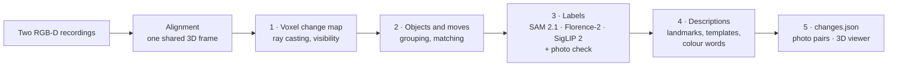

# Approach 1 – `voxel_diff`: visibility-aware voxel differencing + open-vocabulary labelling

This approach decides **geometrically** what changed, then uses **off-the-shelf
open-source models only to name** what it found. Nothing is trained or
fine-tuned, and no data is labelled by hand. Each stage is deterministic, and
its result hash is recorded. `navdelta verify` reruns everything and requires
identical hashes.

Code: [`navdelta/approaches/voxel_diff/`](../navdelta/approaches/voxel_diff/).
Validation notes per step: [`docs/validation/`](validation/).

## Principles

1. **Only compare what both recordings saw.** A spot one recording never looked
   at is *unknown*, never "removed". This is the main defence against false
   changes from incomplete scans.
2. **Geometry decides, models describe.** Positions, distances, rotations and
   the move/no-move decision come from 3D measurements. The vision models only
   name objects.
3. **Every claim is checked against photos.** Each change is shown in
   photographs from both recordings, from matching viewpoints. That check
   exposed two false changes during development (see *What went wrong* below),
   and the pipeline now runs the same check itself.
4. **Say how sure it is.** Labels the two models disagree on are flagged.
   Rotations that can't be measured are not claimed. Tiny changes are listed
   but not interpreted.

## Step 1 – Visibility-aware voxel change map (`change_map.py`)

Both recordings are ray-cast into one 5 cm voxel grid in the shared frame.
- **Per keyframe:** a depth ray ending in a voxel is a *hit*, and the voxels it
  passes through are *free*. Free space stops 10 cm (+1 cm per metre of range)
  short of the measured surface.
- **Evidence per voxel:** OctoMap-style log-odds (hit +0.85, miss −0.40;
  occupied ≥ 1.5, free ≤ −1.2), weighted by each frame's pose support.
- **Change rule:**
  - **added** = occupied in recording 2, free in recording 1, and more than
    10 cm from anything recording 1 saw;
  - **removed** = the reverse.

  The 10 cm tolerance comes from the alignment's held-out check: 99.43% of
  cross-view points agree within 10 cm.
- **Room structure removed:**
  - **Walls:** a deterministic search over every gravity-aligned plane (1°
    steps, ±5 cm slab) finds walls, floor and ceiling. A wall is accepted
    column by column (each 5 cm column needs a continuous run of at least
    1.5 m), so a row of furniture lined up along a wall is not masked.
  - **Not RANSAC:** RANSAC was tried first and dropped, because its random
    sampling changed which walls were found from run to run.
  - **Sheets:** tall, thin changed sheets (continuous runs of at least 1.0 m)
    are split off as *surface changes* such as curtains. The threshold sits
    between the measured heights: objects reach 0.90 m at most, sheets 1.11 m
    at their 10th percentile.
- **Output:** 26-connected regions of at least 10 voxels.
- **Here:** +2,996 / −1,111 raw changed voxels, which become +1,037 / −1,062 object
  voxels after removing structure and sheets. Only **45.8%** of occupied space
  was observed by both recordings.

## Step 2 – Objects and moves (`objects.py`)

**Grouping:** regions become objects when they:
- lie on one connected, object-sized surface of their own recording (at most
  1.2 × 1.2 × 1.5 m), such as a chair's backrest and seat;
- are thin coplanar panels that overlap, such as the two parts of a door; or
- are fragments smaller than a 15 cm cube, which join their neighbour within
  10 cm.

Top or bottom slices holding less than 10% of an object's widest slice are
trimmed. These are misalignment residue along wall edges; one made the
suitcase look 1.2 m tall instead of 0.72 m.

**Matching:** every removed object is compared with every added object:
- **score** = shape^0.5 × height^0.25 × colour^0.25, a weighted geometric mean,
  so one cue at zero rules a pair out:
  - **shape:** the best overlap over yaw (3° steps) and offsets up to ±10 cm;
  - **height:** the top height above the floor;
  - **colour:** CIE colour difference.
- **assignment:** the Hungarian algorithm pairs objects one-to-one, keeping
  pairs that score at least 0.5.
- **Move or push:** a real move crosses space that one recording saw empty.
  If at least 25% of the straight path between the two positions is surface
  present in *both* recordings, the pair is the trailing and leading faces of
  one object that was pushed. Its slide is the changed layer plus the 10 cm
  tolerance (±5 cm).
- **Orientation:** rotation is reported only when the shape fit is at least
  0.6, and as an axis only when front and back can't be told apart. The
  orientation against the nearest wall comes from the rotation applied to the
  old footprint.

## Step 3 – Open-vocabulary labels (`labels.py`)

For each object position:
1. **Views:** up to 5 keyframes where depth confirms the surface, from
   different viewpoints.
2. **Mask:** **SAM 2.1** (Apache-2.0) segments the object, prompted with a box
   and points from the projected voxels.
3. **Upright:** each crop is rotated using the camera pose (the phone video is
   mostly sideways).
4. **Name:** **Florence-2-large** (MIT) names and describes the masked region.
5. **Cross-check:** **SigLIP 2 so400m** (Apache-2.0) scores the crops against
   the 200 classes of the public ScanNet200 benchmark, plus every name
   Florence-2 proposed.
6. **Decision:**
   - **Confirmed:** a strict Florence-2 majority that SigLIP 2's top 3 agrees
     with (same name or same head noun, e.g. "chair" / "office chair"). The
     more specific name is kept.
   - **Otherwise:** SigLIP 2's choice, flagged *uncertain* unless Florence-2
     proposed it somewhere.
7. **Photo check:** the same spot is also labelled in the **other** recording's
   photos. If both recordings name the same object there, the change is
   *depth-only*: thin or see-through material, a slight shift, or local
   misalignment.

Model weights are pinned to exact Hugging Face revisions. They download on
first use and run one at a time in fp16 to fit a 4 GB GPU, or in fp32 on a CPU.

## Step 4 – Descriptions (`landmarks.py`, `colours.py`, `describe.py`)

- **Landmarks:** Florence-2 `<OD>` and SAM 2.1 run on every 3rd keyframe of
  both recordings, and their masks are voted into the voxel grid (at least 3
  frames per voxel). Only pieces present in **both** recordings count. Things
  that changed (the curtain, the moved suitcase) drop out automatically.
- **Sentences:** templates are filled from the measurements. They include:
  - where an object stands: on the floor, or on a piece of furniture;
  - the nearest furniture;
  - the strongest "closer to" and "further from" changes;
  - the rotation, and the orientation relative to the wall;
  - left and right, as seen when facing the window (checked against a photo).
- **Colour words (optional):** **SmolVLM2-500M** (Apache-2.0) answers a single
  question, the main colour, by majority over 3 crops. In a test, its colour
  words were always right, while its shape words were not, so nothing else it
  says is used.

## Step 5 – Results package (`package.py`)

- **`changes.json`:** the common format, see [changes-schema.md](changes-schema.md).
- **Before/after photo pairs:** for every change, the pair of keyframes (one
  per recording) that best shows both the object and the now-empty spot from
  the most similar viewpoint. Score × exp(−distance / 0.6 m) × exp(−angle / 30°).
- **The 3D viewer:** both rooms, changes, arrows and photos, in one static page.

## Results on our room recordings

Staged changes (`room_changes.txt`), all found:

| Staged | Generated description (abridged) |
|---|---|
| The tower ventilator was moved near the table. | The black fan *(label uncertain)* was moved 0.71 m … now 0.02 m from the desk, compared with 0.74 m before. |
| The office chair was moved further away from the table. | The black office chair was moved 0.57 m … now 0.84 m from the desk, compared with 0.20 m before. |
| The travel trolley bag was moved perpendicular to the adjacent wall. | The blue suitcase was moved 0.54 m and turned by roughly 100° (±10°) … its long side used to be parallel to the right-hand wall; now it is perpendicular to it. |

Also reported:
- **Chest of drawers:** pushed about 0.21 m towards the bed.
- **No longer in their spots:** a lamp edge, a shelf item and a plastic bag.
- **Desk:** a change at its front edge.
- **Depth-only (photos show the same object in both):** the sheer curtains and
  the far door.
- **Four tiny changes:** listed, not interpreted.

## What went wrong during development, and what changed

Each of these was found by checking results against photos, and fixed in the
pipeline (not hidden in the text):

| Found | Fix |
|---|---|
| RANSAC wall detection changed between identical runs | deterministic exhaustive plane search |
| A furniture row along a wall was masked as wall, hiding the suitcase's old position | wall test per 5 cm column |
| Window curtains merged with the chair | tall-sheet split, threshold set from measured heights |
| An additive match score paired a shelf item with a curtain 3 m away | weighted geometric mean |
| The two faces of the drawer unit were reported as a 0.58 m move | path-between test (move vs. push) |
| The push was reported as "≤ 0.11 m" | the changed layer + 10 cm tolerance: ~0.21 m |
| A hand-written label list contained the expected answers | published ScanNet200 vocabulary |
| "Curtains drawn closed" and "door moved" (read from one recording's photos only) | photo check in the other recording → depth-only |
| "Lamp gone", while the photos show it slightly shifted | wording: "no longer fills its spot" |

Several thresholds were set while looking at this scene, where the answer was
known. The validation notes say which ones. None of these rules is needed to
find the three staged moves: every version found them. The rules remove false
or unsupported claims.

## Large spaces

The same stages run on warehouses with the `large_space` profile ([`profiles.md`](profiles.md)).
It uses 10 cm voxels, depth up to 12 m, tolerances that grow with range, and pallet-sized
objects. On five ChangeSim warehouse pairs its micro-averaged F1 is 0.31 on the two tuning pairs
and 0.38 on the three held-out ones. Of the four approaches, it finds the most removed objects
(30 %). Details: [`benchmark.md`](benchmark.md).

## Limitations

- **Coverage:** only space observed by both recordings can be compared (45.8%
  of occupied space here). Changes elsewhere are not reported.
- **Detection floor:** about a 15 cm object, from the 5 cm voxels and the 10 cm
  alignment tolerance.
- **Partial views:** matching uses the changed voxels, which are partial views.
  Dark objects of similar size (fan, bag, chair) are told apart mainly by
  height and by the one-to-one assignment.
- **Rotation:** good to about ±10° on elongated objects; not measurable on
  round ones.
- **Labels:** come from general-purpose models. The tower fan is only "fan",
  and Florence-2 never recognised it. The door is labelled "closet wall"
  (flagged). One shelf item can't be identified.
- **One room:** tested on one pair of recordings. Expect the thresholds to need
  checking on other spaces; the validation notes list which were measured on
  this scene.
